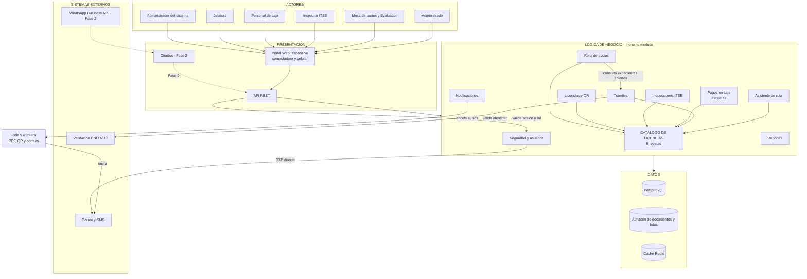
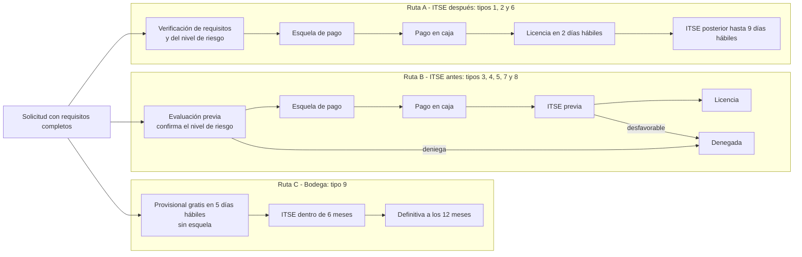

# Arquitectura inicial del sistema

## Estilo arquitectónico
**Monolito modular en tres capas, dirigido por un catálogo de licencias.**
Una sola aplicación organizada en módulos que comparten una base de datos PostgreSQL.
Todos los módulos consultan el **Catálogo de licencias** antes de actuar, por lo que las
reglas del TUPA viven en un solo lugar.

| Capa | Pregunta que responde | Componentes |
|---|---|---|
| Presentación | ¿Cómo interactúa el usuario? | Portal Web responsive (computadora y celular), API REST, chatbot (Fase 2) |
| Lógica de negocio | ¿Qué hace el sistema? | Catálogo, asistente de ruta, trámites, pagos en caja, inspecciones, licencias, notificaciones, reloj de plazos, seguridad y reportes |
| Datos | ¿Dónde se almacena la información? | PostgreSQL, almacén de documentos y fotos, caché Redis |

## Diagrama de arquitectura

## Rutas del trámite

## Catálogo de licencias (las nueve recetas)

| N.° | Licencia | ITSE | Tasa (S/) | Plazo | Calificación | Ruta |
|---|---|---|---|---|---|---|
| 1 | Riesgo bajo | Posterior | 159.50 | 2 días | Automática | A |
| 2 | Riesgo medio | Posterior | 177.10 | 2 días | Automática | A |
| 3 | Riesgo alto | Previa | 305.90 | 8 días | Evaluación previa | B |
| 4 | Riesgo muy alto | Previa | 538.90 | 8 días | Evaluación previa | B |
| 5 | Corporativa | Previa | 529.20 | 8 días | Evaluación previa | B |
| 6 | Cesionarios, riesgo medio | Posterior | 180.40 | 2 días | Automática | A |
| 7 | Cesionarios, riesgo alto | Previa | 309.20 | 8 días | Evaluación previa | B |
| 8 | Cesionarios, riesgo muy alto | Previa | 542.20 | 8 días | Evaluación previa | B |
| 9 | Provisional para bodegas | Posterior (6 meses) | Gratis | 5 días | Automática | C |

Fuente: TUPA 2024 de la Municipalidad Provincial de Huanta. Plazos en días hábiles.

**Regla para que la tasa siempre coincida:** la esquela se genera **después** de confirmar el nivel de riesgo
(en la verificación de requisitos de la ruta A o al terminar la evaluación previa de la ruta B). Si el evaluador
corrige el riesgo, el expediente toma la receta del nuevo nivel (tasa, plazo y ruta) **antes** de generar la esquela.

**Plazo de la ruta B:** los 8 días hábiles del TUPA incluyen la evaluación previa, la ITSE previa (hasta 7 días) y la emisión (1 día).
Los días que el expediente espera el pago en caja dependen del administrado; si se descuentan o no del plazo es un punto **por validar con la Municipalidad**.

## Descripción

- **Presentación:** todos los usuarios entran por el Portal Web, desde computadora o celular con internet. El Portal se comunica con el backend mediante una API REST. En la Fase 2 se suma un chatbot que usa la misma API.
- **Lógica de negocio:** una sola aplicación organizada en módulos. El **Catálogo de licencias** es el corazón: cada módulo lo consulta para saber qué requisitos pedir, qué tasa cobrar, qué ruta seguir y qué plazo controlar.
- **Pago:** en las rutas A y B el sistema genera una **esquela de pago** con la tasa del catálogo; la persona paga en la caja de la Municipalidad y el personal de caja registra el pago. La ruta C (bodega) es gratuita y no genera esquela.
- **Notificaciones:** el módulo Notificaciones solo **encola** los avisos; los **workers** son los que envían los correos y SMS. La única excepción es el **código OTP**, que el módulo Seguridad envía directo porque el usuario lo espera para iniciar sesión.
- **Datos:** PostgreSQL guarda toda la información; los PDF, planos y fotos se guardan en un almacén aparte; Redis acelera el catálogo y el estado de los trámites.

## Despliegue

| Componente | Descripción |
|---|---|
| Servidor de aplicación | Mínimo 2 instancias del backend; se agregan más en los picos (de 1,000 a 10,000 usuarios). |
| Balanceador de carga | Reparte las solicitudes entre las instancias. |
| Base de datos | PostgreSQL con réplica de respaldo y copias diarias. |
| Caché | Redis para el catálogo y el estado de los trámites. |
| Cola y workers | Generan los PDF de esquelas y licencias, los QR y los correos en segundo plano. |
| Almacén de documentos | Guarda PDF, planos y fotos de inspección. |