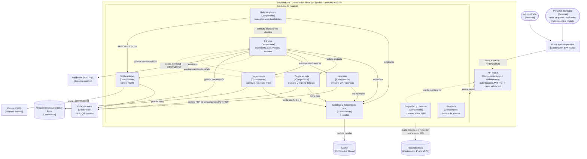

# Componentes arquitectónicos – API de Licencias de Funcionamiento

**Modelo C4 – Nivel 3 (componentes)** del contenedor *Backend API*.
Estilo: monolito modular en capas, con Clean Architecture dentro de cada módulo.

## Diagrama de componentes

**Leyenda:** flecha continua = llamada directa a la interfaz pública de otro módulo; flecha punteada = evento publicado.

**Notas:**
1. Cada componente es un módulo del monolito: todos se despliegan juntos.
2. Un módulo usa a otro **solo a través de su interfaz pública** o de eventos; **nunca accede a sus tablas**.
3. Todos los módulos consultan el **Catálogo** para conocer las reglas del TUPA.
4. No hay pagos digitales: el módulo **Pagos en caja** genera la esquela y registra el pago que hace el personal de caja.

## Responsabilidades y trazabilidad de cada componente

| Componente | Responsabilidad | Historias / requisitos | Driver / ADR | Escenario |
|---|---|---|---|---|
| **API REST** | Única puerta de entrada; autentica, autoriza y valida solicitudes. | Todas las HU · RF16, RF17 | DA03 · ADR-007 | EQ-04 |
| **Seguridad y Usuarios** | Cuentas, roles y segundo factor (OTP) del personal. | RF16, RF17 | DA03 · ADR-007 | EQ-04 |
| **Catálogo y Asistente de ruta** | Guarda las 9 recetas y propone la licencia con 3 preguntas. | HU01, HU03 · RF01, RF02, RF05 | DA01 · ADR-002 | EQ-05, EQ-06 |
| **Trámites** | Registra la solicitud, valida documentos, asigna la ruta y controla el estado del expediente; atiende trámites conectados. | HU02, HU05, HU07, HU12 · RF03, RF04, RF06, RF07, RF09, RF15 | DA01, DA08 · ADR-002, ADR-003 | EQ-01 |
| **Pagos en caja** | Genera la esquela con código único y registra el pago hecho en caja. | HU04, HU13 · RF11, RF12 | DA04 · ADR-004 | EQ-04 |
| **Inspecciones** | Agenda la ITSE, asigna el inspector y guarda el resultado con fotos desde el celular. | HU08 · RF10 | DA01 · ADR-002 | EQ-05 |
| **Licencias** | Emite la licencia con QR, controla vigencias y avisa la renovación del ITSE. | HU06, HU11 · RF13, RF14 | DA03 · ADR-007 | EQ-04 |
| **Reloj de plazos** | Cuenta días hábiles y alerta antes de cada vencimiento. | HU09 · RF08 | DA05 · ADR-006 | EQ-03 |
| **Notificaciones** | Envía correos y SMS en cada avance, en segundo plano. | HU05, HU11 · RF20 | DA02 · ADR-005 | EQ-02 |
| **Reportes** | Tablero de jefatura: trámites, tiempos e ingresos registrados en caja. | HU10 · RF18, RF19 | DA02 · ADR-005 | EQ-01 |

## Ejemplo de trazabilidad completa: componente Pagos en caja

> El componente **Pagos en caja** sale de las historias **HU04** (obtener la esquela) y **HU13** (registrar el pago en caja),
> de los requisitos **RF11 y RF12** y de la restricción **RC11** (el TUPA indica el pago en caja).
> Eso genera el driver **DA04**, resuelto con el **ADR-004** (pago presencial con esquela).
> En el diseño se aplican el patrón **Repository** y el principio **DIP**, y su seguridad se comprueba con el escenario **EQ-04** (solo el rol de caja puede registrar pagos).