# Componentes arquitectónicos – API de Licencias de Funcionamiento

**Modelo C4 – Nivel 3 (componentes)** del contenedor *Backend API*.
Estilo: monolito modular en capas, con Clean Architecture dentro de cada módulo.

Cada componente es un **módulo del monolito**: todos se despliegan juntos y comparten la misma base
de datos, pero cada uno es dueño de sus propias tablas.

## Diagrama de componentes

```mermaid
flowchart TB
    Adm(["Administrado<br/>[Persona]"])
    Per(["Personal municipal<br/>[Persona]<br/>mesa de partes, evaluador, jefatura"])
    Insp(["Inspector ITSE<br/>[Persona]"])

    Front["Portal Web y PWA de inspectores<br/>[Contenedor: SPA React]"]

    subgraph API["Backend API - Contenedor: Node.js + NestJS - monolito modular"]
        Rest["API REST<br/>[Componente: rutas + middlewares]<br/>autenticación JWT + OTP, roles, validación,<br/>límite de solicitudes"]

        subgraph MOD["Módulos de negocio"]
            Seg["Seguridad y Usuarios<br/>[Componente]<br/>cuentas, roles, OTP"]
            Cat["Catálogo y Asistente de ruta<br/>[Componente]<br/>9 recetas versionadas"]
            Tra["Trámites<br/>[Componente]<br/>expediente, documentos, estados"]
            Pag["Pagos<br/>[Componente]<br/>tasa, cobro idempotente"]
            Ins["Inspecciones<br/>[Componente]<br/>agenda y resultado ITSE"]
            Lic["Licencias<br/>[Componente]<br/>emisión, QR, vigencias"]
            Pla["Reloj de plazos<br/>[Componente]<br/>tarea diaria en días hábiles"]
            Not["Notificaciones<br/>[Componente]<br/>correo y SMS"]
            Rep["Reportes<br/>[Componente]<br/>tablero de jefatura"]
        end

        Bit["Bitácora de auditoría<br/>[Componente transversal]<br/>solo escritura"]
    end

    Redis[("Caché<br/>[Contenedor: Redis]")]
    Cola["Cola y workers<br/>[Contenedor]<br/>PDF, QR, correos"]
    BD[("Base de datos<br/>[Contenedor: PostgreSQL]<br/>primaria + réplicas")]
    Obj[("Almacén de documentos y fotos<br/>[Contenedor]")]

    Pasarela["Pasarela de pago<br/>[Sistema externo]"]
    Ident["Validación DNI / RUC<br/>[Sistema externo]"]
    Msg["Correo y SMS<br/>[Sistema externo]"]
    SIAF["SIAF-SP / Trámite documentario<br/>[Sistema externo]"]

    Adm --> Front
    Per --> Front
    Insp --> Front
    Front -->|"llama a la API - HTTPS/JSON"| Rest
    Rest -->|"invoca casos de uso"| MOD

    Tra -->|"lee receta vigente"| Cat
    Pag -->|"calcula la tasa"| Cat
    Ins -->|"lee la ruta A, B o C"| Cat
    Lic -->|"lee vigencias"| Cat
    Pla -->|"lee plazos"| Cat

    Tra -->|"solicita cobro"| Pag
    Pag -.->|"publica: pago confirmado"| Tra
    Tra -->|"agenda ITSE"| Ins
    Ins -.->|"publica: resultado ITSE"| Tra
    Tra -->|"solicita emisión"| Lic
    Pla -->|"consulta expedientes abiertos"| Tra
    Pla -->|"alerta vencimientos"| Not
    Tra -.->|"publica: cambio de estado"| Not
    Seg -.->|"valida cuenta y rol"| Rest

    MOD -.->|"registra cada acción"| Bit

    Cat -->|"cachea recetas"| Redis
    Not --> Cola
    Lic -->|"genera PDF y QR"| Cola
    Tra -->|"guarda documentos"| Obj
    Ins -->|"guarda fotos"| Obj
    MOD -->|"cada módulo lee y escribe sus tablas - SQL"| BD
    Rep -->|"solo lectura - réplica"| BD

    Pag -->|"cobra - HTTPS/REST"| Pasarela
    Tra -->|"valida identidad - HTTPS/REST"| Ident
    Not -->|"envía - HTTPS/REST"| Msg
    Pag -->|"registra ingresos* - API"| SIAF
```

**Leyenda:** flecha continua = llamada directa a la interfaz pública de otro módulo; flecha punteada =
evento publicado o relación transversal.

**Notas:**
1. Cada componente es un módulo del monolito: todos se despliegan juntos.
2. Un módulo usa a otro **solo a través de su interfaz pública** (fachada del módulo) o de eventos; **nunca accede a sus tablas**.
3. Todos los módulos consultan el **Catálogo** para conocer las reglas del TUPA; las reglas no se repiten en cada módulo.
4. *La integración con SIAF-SP se asignó a Pagos para registrar los ingresos por tasas; **falta confirmarlo con la Municipalidad**.

## Responsabilidades y trazabilidad de cada componente

Cada componente existe porque un requisito, un driver o una decisión lo exige:

| Componente | Responsabilidad | Historias / requisitos | Driver / ADR | Escenario |
|---|---|---|---|---|
| **API REST** | Única puerta de entrada; autentica, autoriza, valida y limita solicitudes. | Todas las HU · RF17, RF18 | DA03 · ADR-007 | EQ-04 |
| **Seguridad y Usuarios** | Cuentas, roles y segundo factor (OTP) del personal. | RF17, RF18 | DA03 · ADR-007 | EQ-04 |
| **Catálogo y Asistente de ruta** | Guarda las 9 recetas versionadas y propone la licencia con 3 preguntas. | HU01, HU11 · RF01, RF02, RF20 | DA01 · ADR-002 | EQ-01, EQ-06 |
| **Trámites** | Registra la solicitud, valida documentos, asigna la ruta y controla el estado del expediente; atiende recursos y trámites conectados. | HU02, HU05, HU07, HU13, HU14 · RF03, RF04, RF06, RF07, RF09, RF11, RF16 | DA01, DA10 · ADR-002, ADR-003 | EQ-01 |
| **Pagos** | Calcula la tasa desde el catálogo y cobra de forma idempotente. | HU03, HU04 · RF05, RF12, RF13 | DA04 · ADR-004 | EQ-05 |
| **Inspecciones** | Agenda la ITSE, asigna el inspector y guarda el resultado con fotos. | HU08 · RF10 | DA07 · ADR-008 | EQ-07 |
| **Licencias** | Emite la licencia con QR, controla vigencias y avisa la renovación del ITSE. | HU06, HU12 · RF14, RF15 | DA03 · ADR-007 | EQ-04 |
| **Reloj de plazos** | Cuenta días hábiles y alerta antes de cada vencimiento. | HU09 · RF08 | DA06 · ADR-006 | EQ-09 |
| **Notificaciones** | Envía correos y SMS en cada avance, en segundo plano. | HU05, HU09, HU12 · RF23 | DA02 · ADR-005 | EQ-02 |
| **Reportes** | Tablero de jefatura: trámites, tiempos e ingresos, desde la réplica de lectura. | HU10 · RF21, RF22 | DA02 · ADR-005 | EQ-01 |
| **Bitácora** | Registra toda acción con usuario, fecha y hora; no permite editar ni borrar. | RF19 | DA05 · ADR-007 | EQ-08 |

## Ejemplo de trazabilidad completa: componente Pagos

> El componente **Pagos** sale de las historias **HU03** (conocer la tasa) y **HU04** (pagar en línea sin cobro doble),
> de los requisitos **RF05, RF12 y RF13** y de la restricción de usar una **pasarela externa**.
> Eso genera el driver **DA04**, resuelto con el **ADR-004** (pago idempotente mediante un puerto).
> En el diseño se aplican el patrón **Adapter** y el principio **DIP**, y su calidad se comprueba con el escenario **EQ-05**.