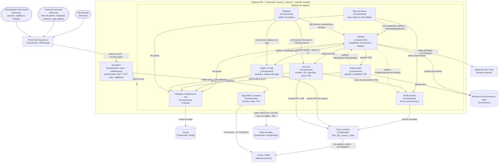

# Componentes arquitectónicos – API de Licencias de Funcionamiento

**Modelo C4 – Nivel 3 (componentes)** del contenedor *Backend API*.
Estilo: monolito modular en capas, con Clean Architecture dentro de cada módulo.

## Diagrama de componentes

**Leyenda:** flecha continua = llamada directa a la fachada pública de otro módulo; flecha punteada = evento publicado.

**Notas:**
1. Cada componente es un módulo del monolito: todos se despliegan juntos.
2. Un módulo usa a otro **solo a través de su fachada pública** o de eventos; **nunca accede a sus tablas ni a sus repositorios**.
3. Los módulos consultan el **Catálogo** para conocer las reglas del TUPA; la tasa existe **solo** en el catálogo.
4. No hay pagos digitales: **Pagos en caja** genera la esquela (rutas A y B) y registra el pago que hace el personal de caja. La ruta C es gratuita y no genera esquela.
5. **Notificaciones** no envía directamente: arma el mensaje y lo deja en la cola; los **workers** lo envían. **Excepción:** el código OTP lo envía Seguridad directamente, porque el usuario lo espera para entrar.
6. Las tareas diarias (Reloj de plazos y aviso ITSE) corren **una sola vez al día** aunque haya varias instancias, gracias a un bloqueo en PostgreSQL (ADR-006).

## Responsabilidades y trazabilidad de cada componente

| Componente | Responsabilidad | Historias / requisitos | Driver / ADR | Escenario |
|---|---|---|---|---|
| **API REST** | Única puerta de entrada; autentica, autoriza y valida solicitudes. | Todas las HU · RF16, RF17 | DA03 · ADR-007 | EQ-04 |
| **Seguridad y Usuarios** | Cuentas, roles y segundo factor (OTP) del personal; envía el OTP directamente. | HU15 · RF16, RF17, RF22 | DA03 · ADR-007 | EQ-04 |
| **Catálogo y Asistente de ruta** | Guarda las 9 recetas, propone la licencia con tres preguntas y permite al administrador actualizar las recetas. | HU01, HU03, HU14 · RF01, RF02, RF05, RF21 | DA01 · ADR-002 | EQ-05, EQ-06 |
| **Trámites** | Registra la solicitud, valida documentos, asigna la ruta, controla el estado del expediente y atiende trámites conectados. | HU02, HU05, HU07, HU12 · RF03, RF04, RF06, RF07, RF09, RF15 | DA01, DA08 · ADR-002, ADR-003 | EQ-01, EQ-04 |
| **Pagos en caja** | Genera la esquela con código único y registra el pago hecho en caja. | HU04, HU13 · RF11, RF12 | DA04 · ADR-004 | EQ-04 |
| **Inspecciones** | Agenda la ITSE, asigna el inspector y guarda el resultado con fotos desde el celular. | HU08 · RF10 | DA01 · ADR-002 | EQ-03 |
| **Licencias** | Emite la licencia con QR, controla vigencias y, con una tarea diaria, avisa la renovación del ITSE. | HU06, HU11 · RF13, RF14 | DA01 · ADR-002 | EQ-04 |
| **Reloj de plazos** | Cuenta días hábiles con el calendario de feriados y alerta antes de cada vencimiento. | HU09, HU16 · RF08, RF23 | DA05 · ADR-006 | EQ-07 |
| **Notificaciones** | Arma los avisos y los encola; los workers envían correos y SMS. | HU05, HU09, HU11 · RF20 | DA02 · ADR-005 | EQ-02 |
| **Reportes** | Tablero de jefatura: lee, sin modificar, expedientes (Trámites), ingresos (Pagos en caja) y licencias e ITSE por vencer (Licencias). | HU10 · RF18, RF19 | DA02 · ADR-005 | EQ-01 |

## Ejemplo de trazabilidad completa: componente Pagos en caja

> El componente **Pagos en caja** sale de las historias **HU04** (obtener la esquela) y **HU13** (registrar el pago en caja),
> de los requisitos **RF11 y RF12** y de la restricción **RC11** (el TUPA indica el pago en caja).
> Eso genera el driver **DA04**, resuelto con el **ADR-004** (pago presencial con esquela).
> En el diseño se aplican el patrón **Repository** y el principio **DIP**, y su seguridad se comprueba con el escenario **EQ-04** (solo el rol de caja puede registrar pagos).