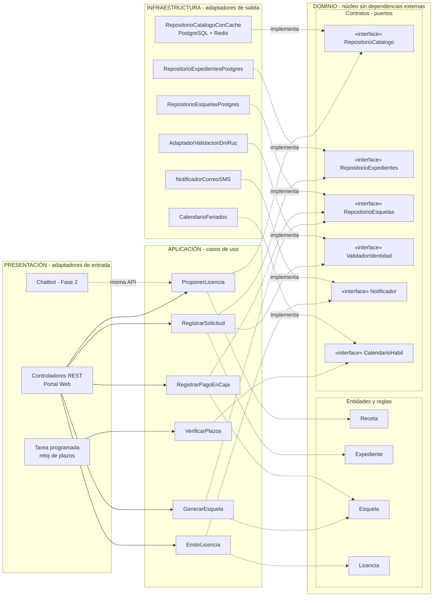

# Enfoque arquitectónico: Clean Architecture

| Elemento | Descripción aplicada al Sistema de Licencias de Huanta |
|---|---|
| Patrón / enfoque | Clean Architecture (Arquitectura Limpia). |
| Objetivo | Proteger las reglas del trámite (catálogo, rutas, tasas y plazos) y hacer que todas las dependencias apunten hacia el dominio. |
| ¿Qué problema resuelve? | Evita que las reglas del TUPA dependan de PostgreSQL, React, el servicio de DNI/RUC o el servicio de correo. |
| Capas definidas | Dominio, Aplicación, Infraestructura y Presentación. |
| Beneficios | Las reglas se prueban sin base de datos; se cambia una tecnología sin tocar el negocio; el chatbot (Fase 2) se agrega como otro adaptador. |
| Driver que responde | DA08 - Independencia del negocio (y DA01). |

## Cómo se organizan las responsabilidades

| Capa | Qué contiene | Ejemplos en el sistema |
|---|---|---|
| **1. Dominio** (centro) | Entidades, objetos de valor, reglas y **contratos** | Entidades: `Expediente`, `Receta`, `Requisito`, `Esquela`, `Inspeccion`, `Licencia`, `CertificadoITSE`. Objetos de valor: `Tasa`, `PlazoDiasHabiles`, `Ruta` (A, B, C), `EstadoExpediente`, `DniRuc`, `CodigoEsquela`. Contratos: `RepositorioCatalogo`, `RepositorioExpedientes`, `RepositorioEsquelas`, `ValidadorIdentidad`, `Notificador`, `AlmacenDocumentos`, `CalendarioHabil`. |
| **2. Aplicación** | Casos de uso: orquestan el dominio usando contratos | `ProponerLicencia`, `RegistrarSolicitud`, `GenerarEsquela`, `RegistrarPagoEnCaja`, `AsignarInspeccion`, `RegistrarResultadoITSE`, `EmitirLicencia`, `VerificarPlazos` |
| **3. Infraestructura** | Adaptadores que **implementan** los contratos | `RepositorioExpedientesPostgres`, `RepositorioEsquelasPostgres`, `RepositorioCatalogoConCache` (Redis), `AdaptadorValidacionDniRuc`, `NotificadorCorreoSMS`, `AlmacenObjetos`, `CalendarioFeriados` |
| **4. Presentación** | Adaptadores de entrada | Controladores REST, tarea programada del reloj de plazos, chatbot (Fase 2) |

## Reglas de negocio que viven en el dominio

1. Una receta define requisitos, tasa, plazo, calificación, orden del ITSE y vigencia.
2. La ruta A emite la licencia antes del ITSE; la ruta B, después; la ruta C emite una provisional gratuita de 12 meses.
3. Una esquela tiene un código único y **solo puede pagarse una vez**.
4. Una licencia no se emite si la esquela no está pagada (salvo la ruta C, que es gratuita).
5. El plazo se cuenta en días hábiles desde la presentación completa.

## Regla de dependencia

1. El **dominio** no importa nada de frameworks, base de datos ni servicios externos.
2. Los **casos de uso** solo conocen entidades y contratos.
3. La **infraestructura** implementa los contratos; sus adaptadores son intercambiables.
4. Un único lugar (la raíz de composición, `app.module`) decide qué adaptador cumple cada contrato.

## Diagrama del enfoque

**Leyenda:** flecha continua = llamada en tiempo de ejecución; flecha punteada = dependencia de código, siempre hacia el dominio; "implementa" = el adaptador cumple el contrato (inversión de dependencias).

## Diferencia con el estilo arquitectónico

| | Estilo (estilo-arquitectonico.md) | Enfoque (este archivo) |
|---|---|---|
| Responde | ¿Cómo es el sistema globalmente? | ¿Cómo se organiza el código por dentro? |
| Decisión | Monolito modular en capas | Clean Architecture |
| Dependencias | De arriba hacia abajo | Hacia el dominio (invertidas) |