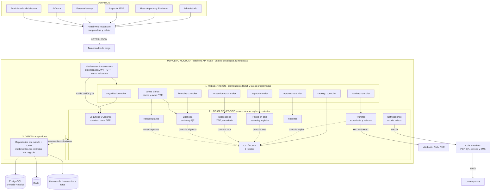

# Estilo arquitectónico

## Estilo seleccionado
**Monolito modular organizado en capas** (ADR-001).

- **Monolito:** el backend es una sola aplicación API REST con un solo despliegue, que se replica en los picos.
- **Modular:** se divide en módulos con límites claros: Seguridad y Usuarios, Catálogo y Asistente de ruta, Trámites, Pagos en caja, Inspecciones, Licencias, Reloj de plazos, Notificaciones y Reportes.
- **En capas:** cada módulo tiene Presentación (controladores), Lógica de negocio (casos de uso y reglas) y Datos (repositorios). Los repositorios **implementan contratos definidos por la lógica de negocio** (Clean Architecture, ADR-003).
- **Centrado en el catálogo:** los módulos consultan el Catálogo para aplicar las reglas del TUPA (ADR-002).

El monolito es la **unidad de despliegue**; las capas son la **organización lógica**. Ambos coexisten.

## Justificación

| Driver | Cómo lo responde el estilo |
|---|---|
| DA07 - Simplicidad | Una sola aplicación y una sola base de datos, fácil de mantener para un equipo pequeño. |
| DA02 - Escalabilidad | El backend no guarda estado y se replica detrás de un balanceador. |
| DA01 - Catálogo | El catálogo concentra las reglas que cambian con el TUPA. |
| DA08 - Fase 2 | El chatbot entra como un canal más de la misma API. |

**Alternativa descartada:** microservicios. Exigen varias bases de datos, orquestación y más personal de TI, sin un beneficio claro para el tamaño de una municipalidad provincial.

## Diagrama del estilo arquitectónico

**Leyenda:** flecha continua = llamada en tiempo de ejecución; flecha punteada = dependencia de código (consulta a otro módulo o "implementa contrato").

## Reglas de la arquitectura

1. En tiempo de ejecución, la petición fluye Presentación → Lógica de negocio → Datos. En el código, la capa de Datos **depende** de la lógica de negocio porque implementa sus contratos (inversión de dependencias, ADR-003).
2. Un módulo no accede a las tablas ni a los repositorios de otro módulo; lo hace a través de su fachada pública o de eventos.
3. Los módulos consultan el **Catálogo** para conocer las reglas del TUPA.
4. Las tareas lentas (PDF de esquelas y licencias, QR, correos y SMS) van a la cola; solo los workers envían mensajes.
5. Todo corre como una sola aplicación, replicable, con una única base de datos principal.