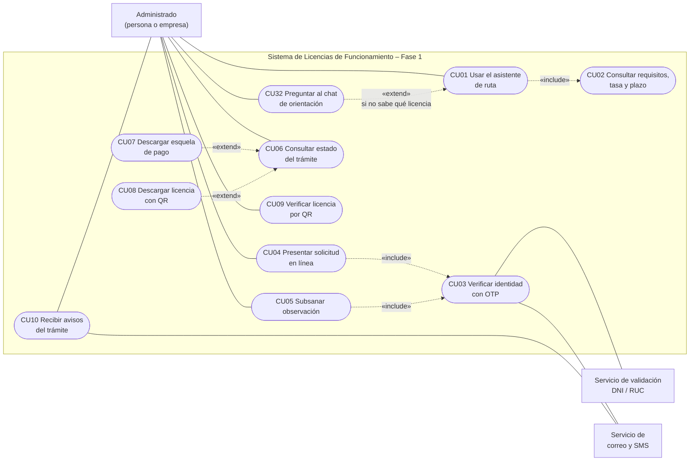
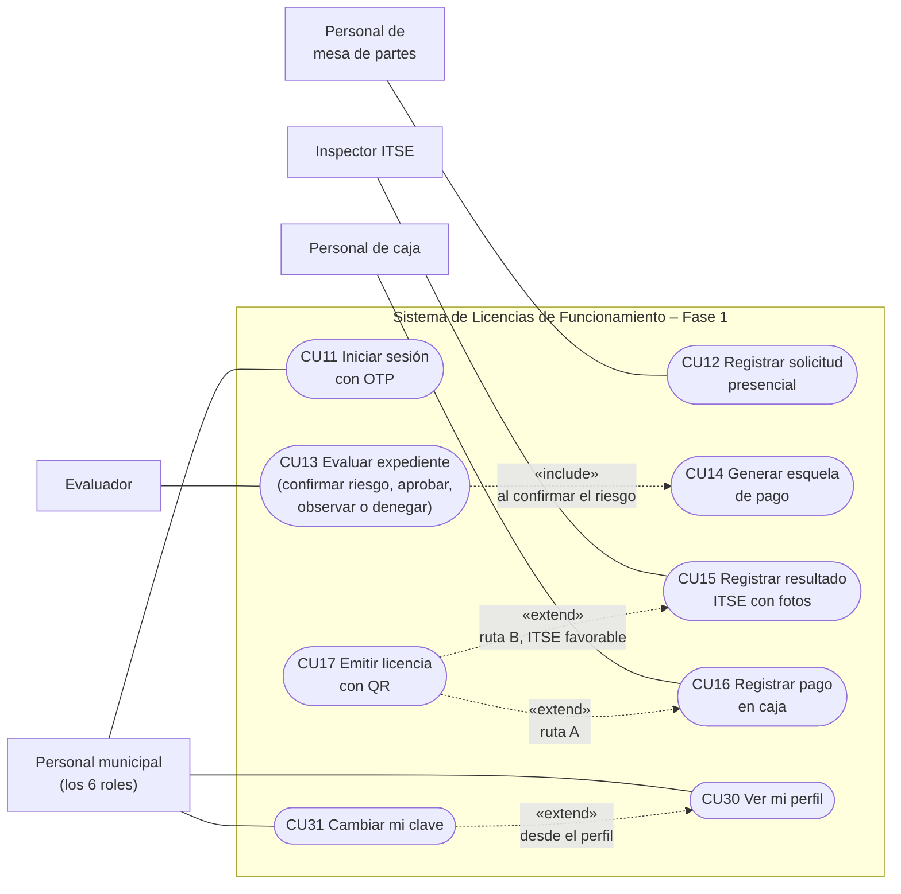
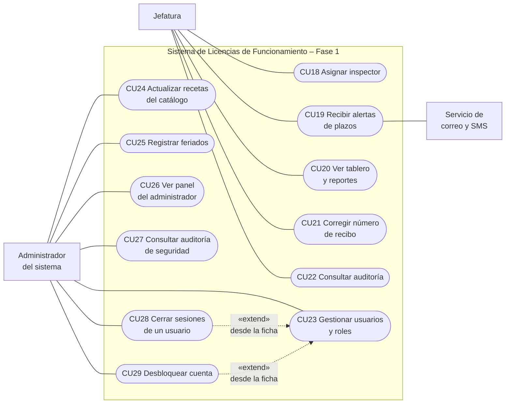

# Diagrama de casos de uso

El sistema tiene **32 casos de uso** repartidos entre 7 actores humanos y 2 sistemas externos de la
Fase 1 (ver [01-actores.md](../01-analisis-de-sistema/01-actores.md)). Cada caso de uso se traza a
sus historias de usuario y requisitos funcionales, y a la funcionalidad SDD que lo construye.

Para que se lea bien, el diagrama se divide en tres vistas: el administrado, el personal operativo y
la supervisión y administración. Las flechas punteadas marcan las relaciones entre casos de uso:

- **«include»** (flecha del caso base al incluido): el caso base **siempre** ejecuta el otro. Por
  ejemplo, presentar una solicitud siempre verifica la identidad.
- **«extend»** (flecha del caso opcional al caso base): el caso opcional agrega su comportamiento
  al base **solo cuando se cumple una condición**. Por ejemplo, emitir la licencia extiende el
  registro del pago solo en la ruta A.

## Vista 1: el administrado

Cualquier persona (por ejemplo, un fiscalizador o un cliente del negocio) puede usar CU09 sin
cuenta: la página pública del QR muestra solo datos mínimos (ADR-007).

## Vista 2: el personal operativo

**Personal municipal** es un actor general: mesa de partes, evaluador, inspector, caja, jefatura y
administrador son casos particulares de él (generalización de actores), así que todos usan CU11
para entrar. El código OTP lo envía el servicio de correo y SMS. Desde la 011, al entrar cada rol
llega a su pantalla principal, y todo el personal puede ver su propio perfil (CU30) y cambiar su
clave cuando quiera desde ahí (CU31). Nadie ve el perfil de otra persona.

## Vista 3: supervisión y administración

La jefatura y el administrador también entran con CU11 (vista 2), como todo el personal municipal.
Desde la 009 el administrador entra directo a su panel (CU26). Su auditoría de seguridad (CU27:
accesos, usuarios y configuración) está separada de la auditoría de la jefatura (CU22: pagos y
decisiones), por separación de funciones.

## Trazabilidad

| CU | Caso de uso | Actor principal | HU | RF | Funcionalidad SDD | Estado |
| --- | --- | --- | --- | --- | --- | --- |
| CU01 | Usar el asistente de ruta | Administrado | HU01 | RF01 | 003 | ✅ Hecho |
| CU02 | Consultar requisitos, tasa y plazo | Administrado | HU01, HU03 | RF02, RF05 | 001 (lista) y 003 (detalle) | ✅ Hecho |
| CU03 | Verificar identidad con OTP | Administrado | HU02 | RF06 | 004 | ✅ Hecho |
| CU04 | Presentar solicitud en línea | Administrado | HU02 | RF04, RF06, RF07 | 004 | ✅ Hecho |
| CU05 | Subsanar observación | Administrado | HU02, HU07 | RF04, RF09 | 005 (el plazo en días hábiles, 006) | ✅ Hecho |
| CU06 | Consultar estado del trámite | Administrado | HU05 | RF03 | 004 | ✅ Hecho |
| CU07 | Descargar esquela de pago | Administrado | HU04 | RF11 | 005 | ✅ Hecho |
| CU08 | Descargar licencia con QR | Administrado | HU06 | RF13 | 006 | ✅ Hecho |
| CU09 | Verificar licencia por QR | Cualquier persona | HU06 | RF13 | 006 | ✅ Hecho |
| CU10 | Recibir avisos del trámite | Administrado | HU05, HU11 | RF14, RF20 | 006 | ✅ Hecho |
| CU11 | Iniciar sesión con OTP | Todo el personal | HU15 | RF16 | 002 | ✅ Hecho |
| CU12 | Registrar solicitud presencial | Mesa de partes | HU02 | RF04, RF07 | 004 | ✅ Hecho |
| CU13 | Evaluar expediente | Evaluador | HU07 | RF07, RF09 | 005 (ruta B con inspección, 006) | ✅ Hecho |
| CU14 | Generar esquela de pago | Sistema (desde CU13) | HU04 | RF05, RF11 | 005 | ✅ Hecho |
| CU15 | Registrar resultado ITSE con fotos | Inspector ITSE | HU08 | RF10 | 006 | ✅ Hecho |
| CU16 | Registrar pago en caja | Personal de caja | HU13 | RF12 | 005 | ✅ Hecho |
| CU17 | Emitir licencia con QR | Sistema (desde CU15 o CU16) | HU06 | RF13, RF25 | 006 | ✅ Hecho |
| CU18 | Asignar inspector | Jefatura | HU08 | RF10 | 006 | ✅ Hecho |
| CU19 | Recibir alertas de plazos | Jefatura | HU09 | RF08 | 006 | ✅ Hecho |
| CU20 | Ver tablero y reportes | Jefatura | HU10 | RF18, RF19 | 007 | ✅ Hecho |
| CU21 | Corregir número de recibo | Jefatura | HU17 | RF24 | 005 | ✅ Hecho |
| CU22 | Consultar auditoría | Jefatura | HU17 | RF25 | 007 | ✅ Hecho |
| CU23 | Gestionar usuarios y roles | Administrador | HU15 | RF17, RF22 | 002 | ✅ Hecho |
| CU24 | Actualizar recetas del catálogo | Administrador | HU14 | RF21 | 003 | ✅ Hecho |
| CU25 | Registrar feriados | Administrador | HU16 | RF23 | 006 | ✅ Hecho |
| CU26 | Ver panel del administrador | Administrador | HU15 | RF17, RF22 | 009 | ✅ Hecho |
| CU27 | Consultar auditoría de seguridad | Administrador | HU15 | RF16, RF22 | 009 | ✅ Hecho |
| CU28 | Cerrar sesiones de un usuario | Administrador | HU15 | RF16, RF22 | 009 | ✅ Hecho |
| CU29 | Desbloquear cuenta | Administrador | HU15 | RF16, RF22 | 009 | ✅ Hecho |
| CU30 | Ver mi perfil | Todo el personal | HU15 | RF16, RF17 | 011 | ✅ Hecho |
| CU31 | Cambiar mi clave | Todo el personal | HU15 | RF16 | 011 | ✅ Hecho |
| CU32 | Preguntar al chat de orientación | Administrado | HU01, HU03 | RF01, RF02 | 012 | ✅ Hecho |

**Cobertura:** las 17 historias de usuario y los 25 requisitos funcionales tienen al menos un caso de
uso, salvo **HU12 / RF15** (transferencia, cambio de giro y duplicado), que queda como trabajo futuro
por alcance del semestre.

## Fuera de la Fase 1

- **Asistente por chat** (WhatsApp Business API, RC13): en la Fase 2 será otro adaptador de entrada
  sobre los mismos casos de uso CU01, CU02 y CU06, sin rehacer la Fase 1 (ADR-003).
- **Trámites conectados** (HU12, RF15): transferencia, cambio de giro y duplicado.
