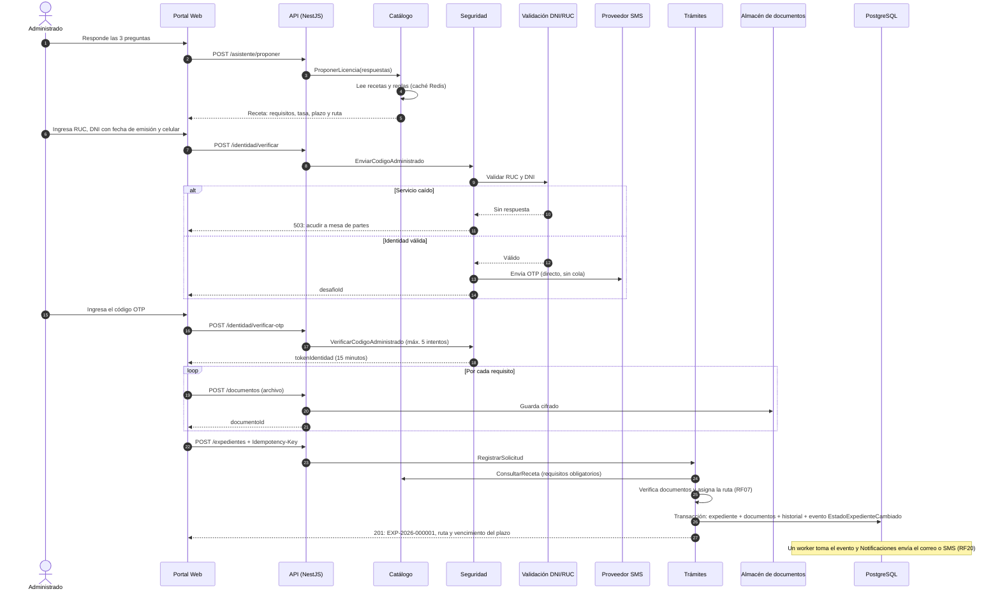
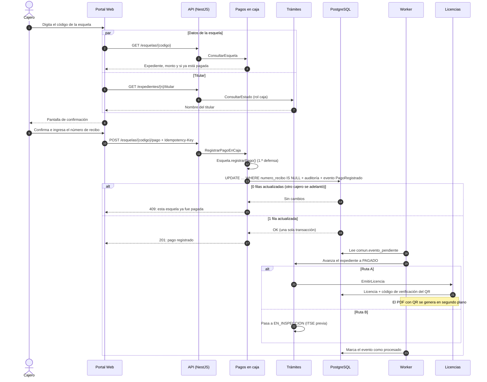

# Diagramas de secuencia

Muestran, paso a paso, cómo colaboran el Portal, la API y los módulos en los dos flujos más críticos del sistema.
Los nombres de las operaciones coinciden con el contrato [`openapi.yaml`](../06-contrato-api/openapi.yaml) y con
los casos de uso del [diseño interno de módulos](diseno-interno/diseno-interno-de-modulos.md).

## 1. Presentar una solicitud en línea (HU01, HU02, RF01, RF04, RF06, RF07)

El administrado elige su licencia con el asistente, confirma su identidad y presenta. Nadie puede presentar a nombre
de otra persona porque la solicitud exige el `tokenIdentidad` que solo se obtiene con el OTP enviado al celular.

## 2. Registrar el pago en caja (HU13, RF11, RF12, ADR-004)

El cajero ve el expediente, el titular y el monto antes de confirmar. El pago, la auditoría y el evento se guardan
en **una sola transacción** (outbox), y la base de datos impide que dos cajeros paguen la misma esquela.

## Qué demuestran

| Escenario | Dónde se ve |
|---|---|
| EQ-04 Seguridad | La solicitud exige `tokenIdentidad`; el OTP tiene límite de intentos; solo el rol caja registra pagos. |
| EQ-03 Disponibilidad | Si el servicio de DNI/RUC cae, el sistema responde 503 y deriva a mesa de partes; el evento del pago no se pierde gracias al outbox. |
| EQ-01 Rendimiento | El catálogo se lee de Redis; los PDF y los mensajes se generan fuera de la petición. |
| ADR-004 | Un solo pago por esquela, protegido por la regla del dominio y por la base de datos. |
