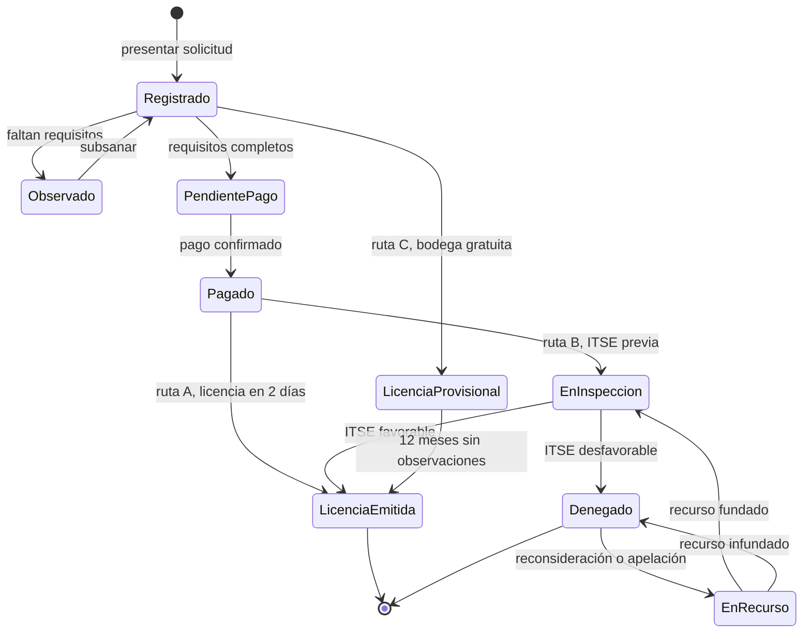

# Diseño interno de los módulos

La arquitectura define **qué módulos existen y cómo se relacionan**. Este documento define
**cómo está organizado cada módulo por dentro**, respetando Clean Architecture (ADR-003):
el dominio en el centro, los casos de uso alrededor y los adaptadores afuera.

## Estructura común de cada módulo

```
src/modulos/<modulo>/
├── dominio/          # entidades, objetos de valor, reglas y contratos (puertos)
├── aplicacion/       # casos de uso
├── infraestructura/  # adaptadores: repositorios PostgreSQL, clientes HTTP, caché
└── presentacion/     # controladores REST, receptores de webhooks, tareas programadas
```

**Regla:** los archivos de `dominio/` no importan nada de NestJS, PostgreSQL, Redis ni librerías HTTP.

## Diseño de cada módulo

| Módulo | Dominio (entidades, objetos de valor, reglas) | Aplicación (casos de uso) | Puertos (contratos) | Adaptadores |
|---|---|---|---|---|
| **Catálogo** | `Receta`, `VersionReceta`, `Requisito`, `Ruta` (A, B, C), `Tasa`, `PlazoDiasHabiles`. Regla: solo una versión vigente por fecha. | `ProponerLicencia`, `ConsultarReceta`, `PublicarVersionCatalogo` | `RepositorioCatalogo` | `RepositorioCatalogoPostgres` + `RepositorioCatalogoConCache` (Redis) |
| **Trámites** | `Expediente`, `Documento`, `EstadoExpediente`, `NumeroExpediente`, `DniRuc`. Regla: el expediente conserva su versión de receta. | `RegistrarSolicitud`, `ObservarExpediente`, `SubsanarObservacion`, `ConfirmarNivelRiesgo`, `RegistrarRecurso`, `ConsultarEstado` | `RepositorioExpedientes`, `ValidadorIdentidad`, `AlmacenDocumentos` | `RepositorioExpedientesPostgres`, `AdaptadorValidacionDniRuc`, `AlmacenObjetos` |
| **Pagos** | `Pago`, `IdentificadorPago`, `Monto`. Regla: un identificador no se cobra dos veces. | `PagarTasa`, `ConfirmarPago`, `ConciliarPagos` | `PasarelaPago`, `RepositorioPagos` | `AdaptadorPasarelaPago`, `PasarelaPagoSimulada` (pruebas), `RepositorioPagosPostgres` |
| **Inspecciones** | `Inspeccion`, `ResultadoITSE`, `Foto`. Regla: una inspección tiene un solo inspector. | `AsignarInspeccion`, `RegistrarResultadoITSE`, `SincronizarInspeccion` | `RepositorioInspecciones`, `AlmacenDocumentos` | `RepositorioInspeccionesPostgres`, `AlmacenObjetos` |
| **Licencias** | `Licencia`, `CertificadoITSE`, `CodigoQR`, `Vigencia`. Regla: no se emite sin pago confirmado, salvo la ruta C. | `EmitirLicencia`, `EmitirLicenciaProvisional`, `VerificarLicenciaPublica` | `RepositorioLicencias`, `GeneradorDocumentos` | `RepositorioLicenciasPostgres`, `GeneradorPdfQr` (worker) |
| **Reloj de plazos** | `Plazo`, `CalendarioHabil`. Regla: se cuentan solo días hábiles. | `VerificarPlazos` | `CalendarioHabil`, `RepositorioExpedientes` (lectura) | `CalendarioFeriadosPostgres` |
| **Notificaciones** | `Mensaje`, `Canal`. | `NotificarCambioEstado`, `NotificarVencimiento` | `Notificador` | `NotificadorCorreoSMS` (vía cola) |
| **Seguridad** | `Usuario`, `Rol`, `CodigoOTP`. | `IniciarSesion`, `VerificarOTP`, `AsignarRol` | `RepositorioUsuarios`, `EnviadorOTP` | `RepositorioUsuariosPostgres`, `EnviadorOtpSms` |
| **Bitácora** (transversal) | `RegistroBitacora`. Regla: solo se agregan registros. | `RegistrarAccion` | `Bitacora` | `BitacoraSoloEscritura` (PostgreSQL sin permisos de UPDATE ni DELETE) |

## Comunicación entre módulos

1. **Llamada directa:** un módulo usa la **fachada pública** de otro (por ejemplo, Trámites llama a `ModuloPagos.solicitarCobro()`). Nunca accede a sus repositorios ni a sus tablas.
2. **Eventos de dominio:** cuando algo importante ocurre, el módulo publica un evento y otros reaccionan, sin acoplarse:
   - `PagoConfirmado` → Trámites avanza el expediente.
   - `ResultadoITSERegistrado` → Trámites decide si se emite la licencia.
   - `EstadoExpedienteCambiado` → Notificaciones avisa al administrado y Bitácora lo registra.

## Ciclo de vida del expediente

El estado del expediente depende de la **ruta de su receta**:



En la ruta A, la ITSE se programa **después** de emitir la licencia y el certificado se renueva cada 2 años.

## Ejemplo de flujo interno: pagar la tasa

```
pagos.controller (presentación)
   → PagarTasa (aplicación)
       → Expediente y Receta: obtiene la tasa vigente (dominio)
       → Pago.crear(identificadorUnico) (dominio)
       → PasarelaPago.cobrar() (puerto)
           → AdaptadorPasarelaPago (infraestructura) → pasarela externa
webhook de la pasarela (presentación)
   → ConfirmarPago (aplicación) → publica PagoConfirmado
```

El caso de uso no sabe qué pasarela se usa: solo conoce el contrato `PasarelaPago`.