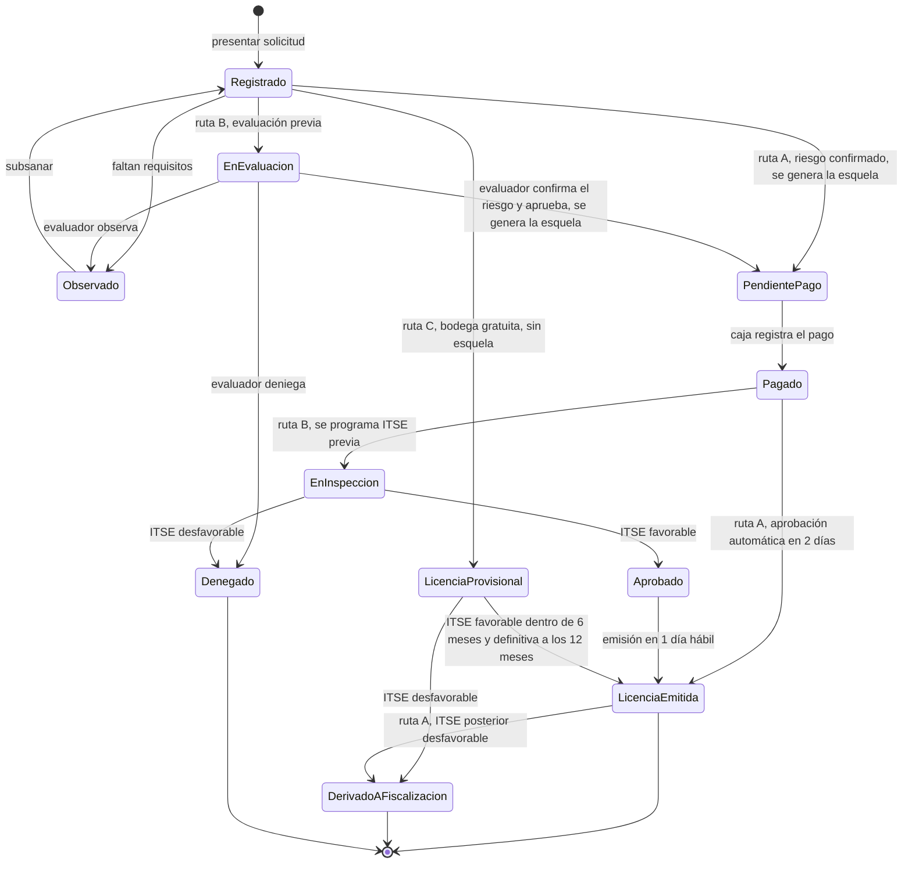

# Diseño interno de los módulos

La arquitectura define **qué módulos existen y cómo se relacionan**. Este documento define
**cómo está organizado cada módulo por dentro**, respetando Clean Architecture (ADR-003).

## Estructura común de cada módulo

```
src/modulos/<modulo>/
├── dominio/          # entidades, objetos de valor, reglas y contratos (puertos)
├── aplicacion/       # casos de uso
├── infraestructura/  # adaptadores: repositorios PostgreSQL, clientes HTTP, caché
└── presentacion/     # controladores REST y tareas programadas
```

**Regla:** los archivos de `dominio/` no importan nada de NestJS, PostgreSQL, Redis ni librerías HTTP.

## Diseño de cada módulo

| Módulo | Dominio (entidades, objetos de valor, reglas) | Aplicación (casos de uso) | Puertos (contratos) | Adaptadores |
|---|---|---|---|---|
| **Seguridad y Usuarios** | `Usuario`, `Rol`, `CodigoOTP`. | `IniciarSesion`, `VerificarOTP`, `GestionarUsuario`, `AsignarRol` | `RepositorioUsuarios`, `EnviadorOTP` | `RepositorioUsuariosPostgres`, `EnviadorOtpSms` (envío directo, sin cola: es la única excepción porque el usuario espera el código para entrar) |
| **Catálogo y Asistente de ruta** | `Receta`, `Requisito`, `Ruta` (A, B, C), `Tasa`, `PlazoDiasHabiles`. | `ProponerLicencia`, `ConsultarReceta`, `ActualizarReceta` (administrador) | `RepositorioCatalogo` | `RepositorioCatalogoPostgres` + `RepositorioCatalogoConCache` (Redis, patrón Decorator) |
| **Trámites** | `Expediente`, `Documento`, `EstadoExpediente`, `NumeroExpediente`, `DniRuc`. Regla: el administrado consulta solo con número de expediente **y** DNI/RUC. | `RegistrarSolicitud`, `ObservarExpediente`, `SubsanarObservacion`, `ConfirmarNivelRiesgo`, `AprobarEvaluacion`, `DenegarExpediente`, `ConsultarEstado` | `RepositorioExpedientes`, `ValidadorIdentidad`, `AlmacenDocumentos` | `RepositorioExpedientesPostgres`, `AdaptadorValidacionDniRuc`, `AlmacenObjetos` |
| **Pagos en caja** | `Esquela`, `CodigoEsquela`, `Monto`, `NumeroRecibo`. Regla: una esquela solo se paga una vez. | `GenerarEsquela`, `RegistrarPagoEnCaja` | `RepositorioEsquelas` (con `siguienteSecuencial` y `guardarPago` atómicos), `ConsultaTasa`, `GeneradorDocumentos`, `PublicadorEventos` | `RepositorioEsquelasPostgres`, `ConsultaTasaCatalogo`, `GeneradorPdf` (worker), `PublicadorEventosNest` |
| **Inspecciones** | `Inspeccion`, `ResultadoITSE`, `Foto`. Regla: una inspección tiene un solo inspector. | `AsignarInspeccion`, `RegistrarResultadoITSE` | `RepositorioInspecciones`, `AlmacenDocumentos` | `RepositorioInspeccionesPostgres`, `AlmacenObjetos` |
| **Licencias** | `Licencia`, `CertificadoITSE`, `CodigoQR`, `Vigencia`. Regla: no se emite sin pago registrado, salvo la ruta C. | `EmitirLicencia`, `EmitirLicenciaProvisional`, `VerificarLicenciaPublica`, `AvisarVencimientoITSE` (tarea diaria con bloqueo, ADR-006) | `RepositorioLicencias`, `GeneradorDocumentos` | `RepositorioLicenciasPostgres`, `GeneradorPdfQr` (worker) |
| **Reloj de plazos** | `Plazo`, `Feriado`. Regla: se cuentan solo días hábiles. | `VerificarPlazos` (tarea diaria con bloqueo, ADR-006), `RegistrarFeriado` (administrador) | `CalendarioHabil`, `ConsultaExpedientes` (solo lectura) | `CalendarioFeriadosPostgres`, `ConsultaExpedientesTramites` (usa la fachada de Trámites) |
| **Notificaciones** | `Mensaje`, `Canal`. | `NotificarCambioEstado`, `NotificarVencimiento` | `Notificador` | `NotificadorEnCola` (deja el mensaje en la cola; el worker lo envía con `NotificadorCorreoSMS`) |
| **Reportes** | `Indicador`. | `GenerarTablero`, `GenerarReporte` | `ConsultaExpedientes`, `ConsultaPagos`, `ConsultaLicencias` (solo lectura) | Adaptadores que usan las fachadas de Trámites, Pagos en caja y Licencias |

## Comunicación entre módulos

1. **Llamada directa:** un módulo usa la **fachada pública** de otro (por ejemplo, Trámites llama a `ModuloPagos.generarEsquela(numeroExpediente, codigoReceta)`). Nunca accede a sus repositorios ni a sus tablas.
2. **Puertos hacia otros módulos:** cuando un caso de uso necesita un dato de otro módulo, lo pide mediante un contrato propio (`ConsultaTasa`, `ConsultaExpedientes`); el adaptador de ese contrato llama a la fachada del otro módulo.
3. **Eventos de dominio:** cuando algo importante ocurre, el módulo publica un evento y otros reaccionan:
   - `PagoRegistrado` → Trámites marca el expediente como pagado y lo avanza.
   - `ResultadoITSERegistrado` → Trámites emite o deniega según la ruta.
   - `EstadoExpedienteCambiado` → Notificaciones encola el aviso al administrado.

## Ciclo de vida del expediente



- **Ruta A:** después de emitir la licencia, Inspecciones programa la **ITSE posterior** (hasta 9 días hábiles); el certificado se renueva cada 2 años. Si la ITSE posterior es **desfavorable**, el sistema registra el resultado, avisa a la jefatura y deriva el caso a fiscalización (fuera del alcance del sistema).
- **Ruta B:** primero la evaluación previa (el evaluador confirma o corrige el riesgo), luego la esquela y el pago, después la ITSE previa. Si el evaluador corrige el riesgo, el expediente toma la receta del nuevo nivel **antes** de generar la esquela, así el monto pagado siempre coincide. Todo esto está dentro de los 8 días hábiles del TUPA.
- **Ruta C:** licencia provisional gratuita de 12 meses; la ITSE se realiza dentro de los primeros 6 meses. Si es desfavorable, se deriva a fiscalización igual que en la ruta A.

## Ejemplo de flujo interno: pago en caja

```
1. Riesgo confirmado: verificación de requisitos (ruta A) o evaluación previa aprobada (ruta B)
2. Trámites llama a ModuloPagos.generarEsquela(numeroExpediente, codigoReceta)
     → GenerarEsquela (aplicación)
     → ConsultaTasa.tasaDe(codigoReceta)          // la tasa sale del catálogo
     → RepositorioEsquelas.siguienteSecuencial(expediente)   // atómico
     → CodigoEsquela: ESQ-<expediente>-<secuencial> (único)
     → GeneradorDocumentos: PDF de la esquela (worker)
3. El administrado paga en la caja de la Municipalidad.
4. pagos.controller (rol caja) → RegistrarPagoEnCaja (aplicación)
     → RepositorioEsquelas.buscarPorCodigo(codigo)
     → Esquela.registrarPago(numeroRecibo)   // falla si ya estaba pagada
     → RepositorioEsquelas.guardarPago(esquela)  // atómico: falla si otro cajero la pagó al mismo tiempo
     → PublicadorEventos.publicar(PagoRegistrado) → Trámites avanza el expediente
```

**Para que el evento no se pierda (en producción):** en lugar del paso `publicar()`, el pago y el evento
`PagoRegistrado` se guardan **en una sola operación** de PostgreSQL, y el evento **solo** se guarda si el pago se
registró (queda en la tabla `eventos_pendientes`). Los **workers** leen esa tabla y entregan el evento a Trámites;
si la entrega falla, la reintentan. Así nunca hay un pago registrado con el expediente detenido, ni un evento de un
pago que no ocurrió. A esta técnica se le llama **outbox**. El ejemplo de `tecnologia/README.md` publica directo
para ser simple.