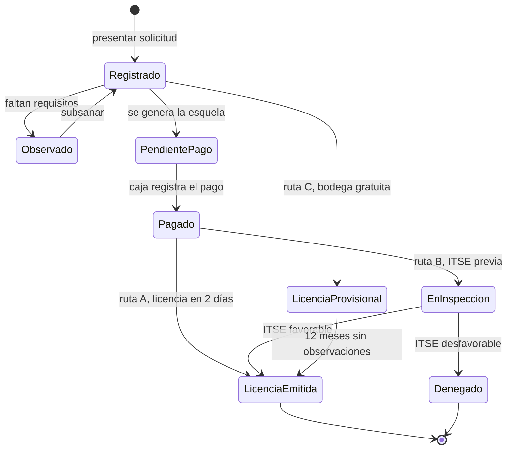

# Diseño interno de los módulos

La arquitectura define **qué módulos existen y cómo se relacionan**. Este documento define
**cómo está organizado cada módulo por dentro**, respetando Clean Architecture (ADR-003).

## Estructura común de cada módulo

```
src/modulos/<modulo>/
├── dominio/          # entidades, objetos de valor, reglas y contratos (puertos)
├── aplicacion/       # casos de uso
├── infraestructura/  # adaptadores: repositorios PostgreSQL, clientes HTTP, caché
└── presentacion/     # controladores REST y tareas programadas
```

**Regla:** los archivos de `dominio/` no importan nada de NestJS, PostgreSQL, Redis ni librerías HTTP.

## Diseño de cada módulo

| Módulo | Dominio (entidades, objetos de valor, reglas) | Aplicación (casos de uso) | Puertos (contratos) | Adaptadores |
|---|---|---|---|---|
| **Catálogo** | `Receta`, `Requisito`, `Ruta` (A, B, C), `Tasa`, `PlazoDiasHabiles`. | `ProponerLicencia`, `ConsultarReceta`, `ActualizarReceta` | `RepositorioCatalogo` | `RepositorioCatalogoPostgres` + `RepositorioCatalogoConCache` (Redis) |
| **Trámites** | `Expediente`, `Documento`, `EstadoExpediente`, `NumeroExpediente`, `DniRuc`. | `RegistrarSolicitud`, `ObservarExpediente`, `SubsanarObservacion`, `ConfirmarNivelRiesgo`, `ConsultarEstado` | `RepositorioExpedientes`, `ValidadorIdentidad`, `AlmacenDocumentos` | `RepositorioExpedientesPostgres`, `AdaptadorValidacionDniRuc`, `AlmacenObjetos` |
| **Pagos en caja** | `Esquela`, `CodigoEsquela`, `Monto`, `NumeroRecibo`. Regla: una esquela solo se paga una vez. | `GenerarEsquela`, `RegistrarPagoEnCaja` | `RepositorioEsquelas`, `GeneradorDocumentos` | `RepositorioEsquelasPostgres`, `GeneradorPdf` (worker) |
| **Inspecciones** | `Inspeccion`, `ResultadoITSE`, `Foto`. Regla: una inspección tiene un solo inspector. | `AsignarInspeccion`, `RegistrarResultadoITSE` | `RepositorioInspecciones`, `AlmacenDocumentos` | `RepositorioInspeccionesPostgres`, `AlmacenObjetos` |
| **Licencias** | `Licencia`, `CertificadoITSE`, `CodigoQR`, `Vigencia`. Regla: no se emite sin esquela pagada, salvo la ruta C. | `EmitirLicencia`, `EmitirLicenciaProvisional`, `VerificarLicenciaPublica` | `RepositorioLicencias`, `GeneradorDocumentos` | `RepositorioLicenciasPostgres`, `GeneradorPdfQr` (worker) |
| **Reloj de plazos** | `Plazo`, `CalendarioHabil`. Regla: se cuentan solo días hábiles. | `VerificarPlazos` | `CalendarioHabil`, `RepositorioExpedientes` (lectura) | `CalendarioFeriadosPostgres` |
| **Notificaciones** | `Mensaje`, `Canal`. | `NotificarCambioEstado`, `NotificarVencimiento` | `Notificador` | `NotificadorCorreoSMS` (vía cola) |
| **Seguridad** | `Usuario`, `Rol`, `CodigoOTP`. | `IniciarSesion`, `VerificarOTP`, `AsignarRol` | `RepositorioUsuarios`, `EnviadorOTP` | `RepositorioUsuariosPostgres`, `EnviadorOtpSms` |

## Comunicación entre módulos

1. **Llamada directa:** un módulo usa la **fachada pública** de otro (por ejemplo, Trámites llama a `ModuloPagos.generarEsquela()`). Nunca accede a sus repositorios ni a sus tablas.
2. **Eventos de dominio:** cuando algo importante ocurre, el módulo publica un evento y otros reaccionan:
   - `PagoRegistrado` → Trámites avanza el expediente.
   - `ResultadoITSERegistrado` → Trámites decide si se emite la licencia.
   - `EstadoExpedienteCambiado` → Notificaciones avisa al administrado.

## Ciclo de vida del expediente



En la ruta A, la ITSE se programa **después** de emitir la licencia y el certificado se renueva cada 2 años.

## Ejemplo de flujo interno: pago en caja

```
1. tramites.controller → RegistrarSolicitud → requisitos completos
2. GenerarEsquela (aplicación)
     → Receta: obtiene la tasa (dominio)
     → Esquela.crear(codigoUnico, monto) (dominio)
     → GeneradorDocumentos: PDF de la esquela (worker)
3. El administrado paga en la caja de la Municipalidad.
4. pagos.controller (rol caja) → RegistrarPagoEnCaja (aplicación)
     → RepositorioEsquelas.buscar(codigo)
     → Esquela.registrarPago(numeroRecibo)   // falla si ya estaba pagada
     → publica PagoRegistrado → Trámites avanza el expediente
```