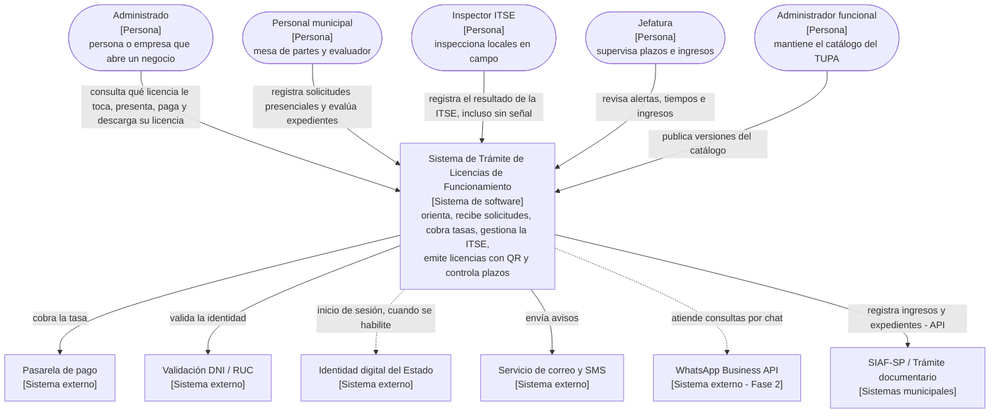

# C4 – Nivel 1: Diagrama de contexto del sistema

**Qué muestra:** el sistema como una sola caja, las personas que lo usan y los sistemas externos con
los que se comunica. Sirve para explicar el alcance a cualquier persona, incluso no técnica.

## Elementos

| Elemento | Tipo | Relación con el sistema |
|---|---|---|
| Administrado | Persona | Usa el Portal Web o el celular para hacer su trámite. |
| Personal municipal | Persona | Registra solicitudes presenciales y evalúa expedientes. |
| Inspector ITSE | Persona | Registra inspecciones desde la PWA, incluso sin señal. |
| Jefatura | Persona | Supervisa plazos, tiempos de atención e ingresos. |
| Administrador funcional | Persona | Mantiene las 9 recetas y sus versiones. |
| Pasarela de pago | Sistema externo | Procesa los pagos digitales. |
| Validación DNI / RUC | Sistema externo | Valida la identidad del solicitante. |
| Identidad digital del Estado | Sistema externo | Inicio de sesión del administrado, cuando la Municipalidad lo habilite. |
| Correo y SMS | Sistema externo | Envía las notificaciones. |
| WhatsApp Business API | Sistema externo (Fase 2) | Canal del asistente virtual. |
| SIAF-SP / Trámite documentario | Sistemas municipales | Integración por API; no se modernizan (fuera de alcance). |

**Límite del sistema:** el TUPA, la matriz de riesgo y la fiscalización en campo quedan fuera; el
sistema los lee o registra su resultado, pero no los define.