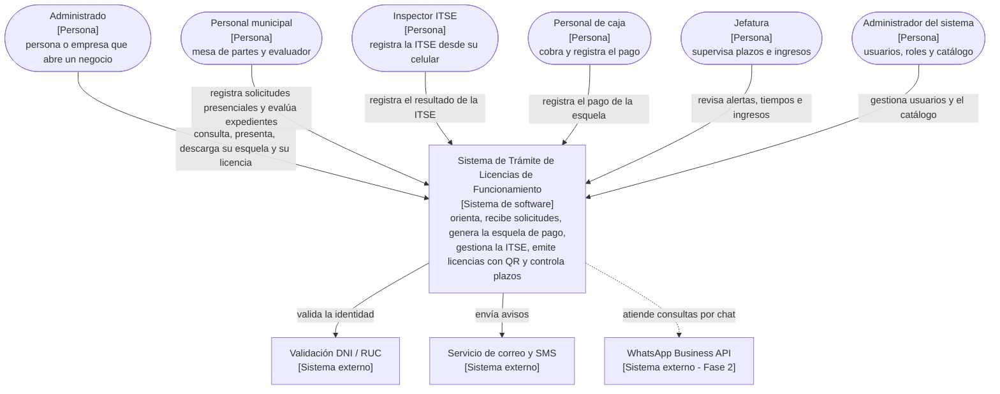

# C4 – Nivel 1: Diagrama de contexto del sistema

**Qué muestra:** el sistema como una sola caja, las personas que lo usan y los sistemas externos con
los que se comunica.

## Elementos

| Elemento | Tipo | Relación con el sistema |
|---|---|---|
| Administrado | Persona | Hace su trámite desde el Portal Web y paga en caja con su esquela. |
| Personal municipal | Persona | Registra solicitudes presenciales y evalúa expedientes. |
| Inspector ITSE | Persona | Registra la inspección con fotos desde su celular, con internet. |
| Personal de caja | Persona | Cobra la tasa y registra el pago con el código de la esquela. |
| Jefatura | Persona | Supervisa plazos, tiempos de atención e ingresos. |
| Administrador del sistema | Persona | Gestiona usuarios, roles y el catálogo de recetas. |
| Validación DNI / RUC | Sistema externo | Valida la identidad del solicitante. |
| Correo y SMS | Sistema externo | Envía las notificaciones. |
| WhatsApp Business API | Sistema externo (Fase 2) | Canal del asistente virtual. |

**Límite del sistema:** no procesa pagos digitales, no define el TUPA ni la matriz de riesgo y no hace la fiscalización en campo.