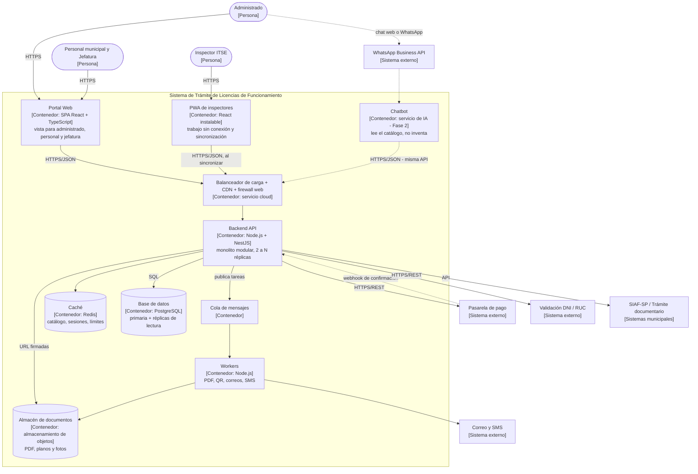

# C4 – Nivel 2: Diagrama de contenedores

**Qué muestra:** las aplicaciones y almacenes de datos que forman el sistema, la tecnología de cada
uno y cómo se comunican. En C4, un "contenedor" es cualquier cosa que se ejecuta o guarda datos
(no significa Docker).

## Contenedores

| Contenedor | Tecnología propuesta | Responsabilidad | Decisión |
|---|---|---|---|
| Portal Web | React + TypeScript (SPA responsive) | Única entrada web, con una vista por perfil. | ADR-001 |
| PWA de inspectores | React instalable | Registrar la ITSE sin conexión y sincronizar. | ADR-008 |
| Chatbot (Fase 2) | Servicio de IA conectado a la API | Responder con datos del catálogo; derivar a una persona. | ADR-003 |
| Balanceador + CDN + firewall | Servicio del proveedor cloud | Repartir carga, servir archivos estáticos y bloquear abusos. | ADR-005 |
| Backend API | Node.js + NestJS | Monolito modular con Clean Architecture; sin estado para poder replicarse. | ADR-001, ADR-003 |
| Workers + cola | Node.js + cola de mensajes | Tareas lentas en segundo plano. | ADR-005 |
| Caché | Redis | Catálogo, estado de trámites, sesiones y límite de solicitudes. | ADR-005 |
| Base de datos | PostgreSQL con réplicas | Toda la información; escrituras en la primaria y lecturas en réplicas. | ADR-001, ADR-005 |
| Almacén de documentos | Almacenamiento de objetos | Archivos pesados fuera de la base de datos. | ADR-005 |

Las tecnologías son **propuestas** (etapa 11 del proceso): la arquitectura no depende de ellas gracias a Clean Architecture.