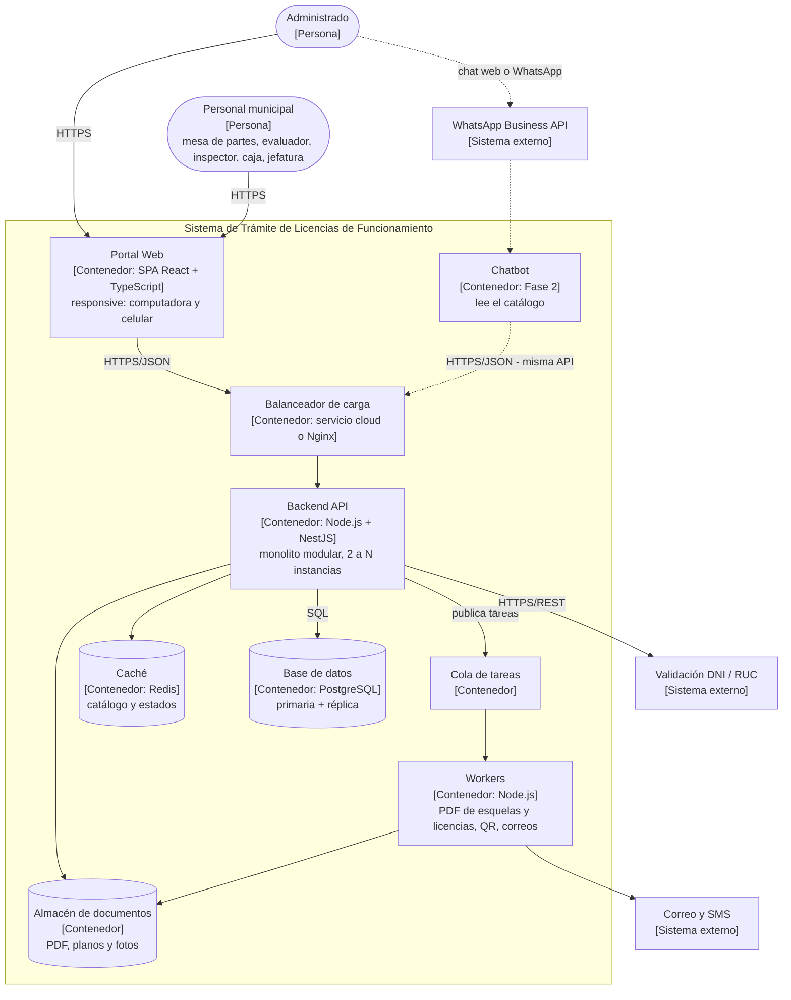

# C4 – Nivel 2: Diagrama de contenedores

**Qué muestra:** las aplicaciones y almacenes de datos que forman el sistema, su tecnología y cómo
se comunican. En C4, un "contenedor" es cualquier cosa que se ejecuta o guarda datos (no significa Docker).

## Contenedores

| Contenedor | Tecnología propuesta | Responsabilidad | Decisión |
|---|---|---|---|
| Portal Web | React + TypeScript (SPA responsive) | Única entrada, con una vista por perfil; el inspector la usa desde su celular. | ADR-001 |
| Chatbot (Fase 2) | Servicio conectado a la API | Responder con datos del catálogo. | ADR-003 |
| Balanceador de carga | Servicio cloud o Nginx | Repartir las solicitudes entre las instancias. | ADR-005 |
| Backend API | Node.js + NestJS | Monolito modular con Clean Architecture; sin estado para poder replicarse. | ADR-001, ADR-003 |
| Workers + cola | Node.js + cola de tareas | PDF de esquelas y licencias, QR y correos en segundo plano. | ADR-005 |
| Caché | Redis | Catálogo y estado de trámites. | ADR-005 |
| Base de datos | PostgreSQL con réplica | Toda la información del sistema. | ADR-001, ADR-005 |
| Almacén de documentos | Almacenamiento de objetos | Archivos pesados fuera de la base de datos. | ADR-005 |

Las tecnologías son **propuestas**: la arquitectura no depende de ellas gracias a Clean Architecture.