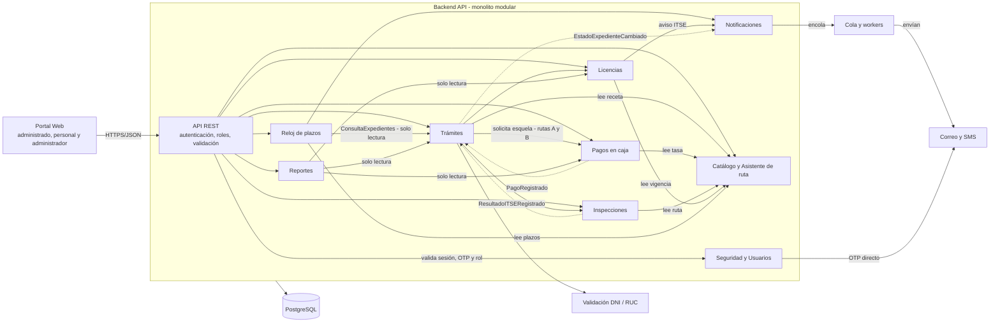

# C4 – Nivel 3: Diagrama de componentes

**Qué muestra:** los componentes que hay **dentro del contenedor Backend API**.
Cada componente es un **módulo del monolito modular**.

El diagrama completo, con la tabla de responsabilidades y la trazabilidad de cada componente, está en:

➡️ [`docs/02-arquitectura-software/componentes-arquitectonicos.md`](../02-arquitectura-software/componentes-arquitectonicos.md)

## Vista resumida

## Reglas del nivel de componentes

1. Todos los componentes se despliegan juntos (monolito modular, ADR-001).
2. Un componente usa a otro solo por su fachada pública o por eventos; nunca por sus tablas ni sus repositorios.
3. Los componentes consultan el Catálogo para aplicar las reglas del TUPA (ADR-002); la tasa vive solo ahí.
4. Notificaciones solo encola; los workers envían los correos y SMS (ADR-005). Excepción: Seguridad envía el OTP directo.
5. Las tareas diarias del Reloj de plazos y del aviso ITSE corren una sola vez al día, con un bloqueo en PostgreSQL (ADR-006).
6. Dentro de cada componente se aplica Clean Architecture (ADR-003); ese detalle se ve en el Nivel 4.