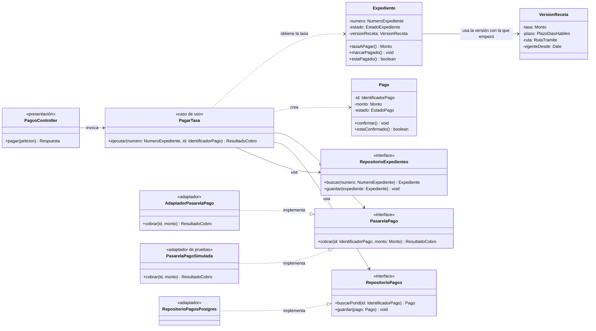

# C4 – Nivel 4: Diagrama de código

**Qué muestra:** las clases e interfaces de un componente. Se documenta solo el componente más
crítico: **Pagos**, junto con su relación con **Trámites** y **Catálogo**, porque concentra las
decisiones ADR-003 (Clean Architecture) y ADR-004 (pago idempotente).

## Cómo leer el diagrama

| Capa | Clases |
|---|---|
| **Dominio** | `Expediente`, `VersionReceta`, `Pago` y los contratos `PasarelaPago`, `RepositorioPagos`, `RepositorioExpedientes` |
| **Aplicación** | `PagarTasa` |
| **Infraestructura** | `AdaptadorPasarelaPago`, `PasarelaPagoSimulada`, `RepositorioPagosPostgres` |
| **Presentación** | `PagosController` |

**Regla de idempotencia:** antes de cobrar, `PagarTasa` busca el `IdentificadorPago`. Si ese pago ya
existe, devuelve su resultado y **no vuelve a cobrar**.

Las flechas `..|>` muestran la **inversión de dependencias**: los adaptadores dependen de los contratos
del dominio, nunca al revés. El código de ejemplo está en `tecnologia/README.md`.