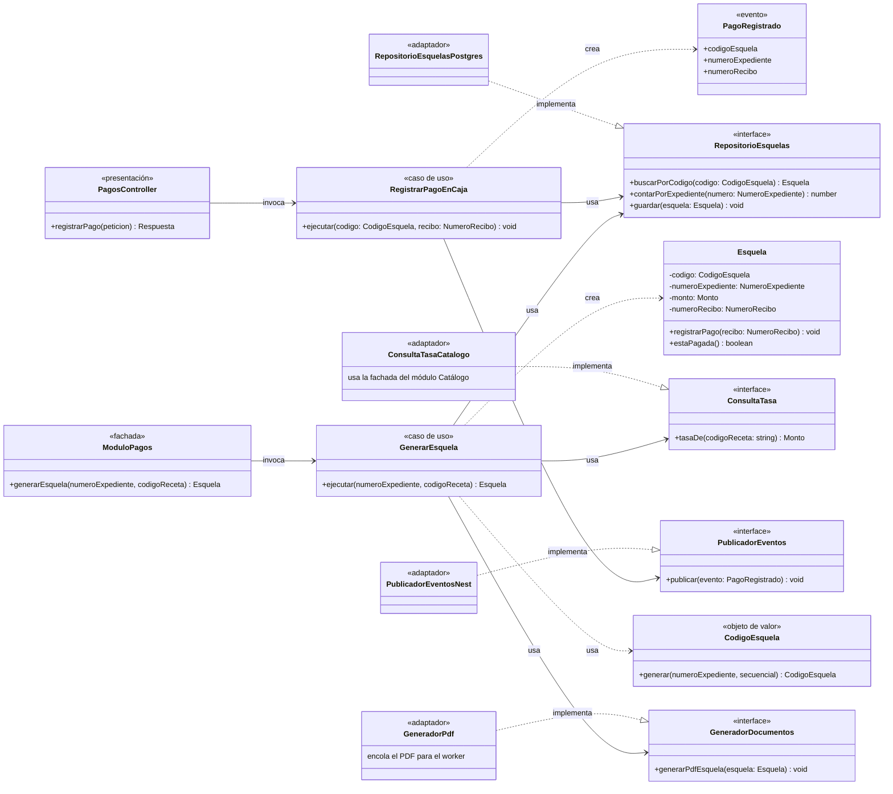

# C4 – Nivel 4: Diagrama de código

**Qué muestra:** las clases e interfaces de un componente. Se documenta el componente
**Pagos en caja**, porque concentra la decisión ADR-004 (pago presencial con esquela) y muestra
Clean Architecture (ADR-003).

## Cómo leer el diagrama

| Capa | Clases |
|---|---|
| **Dominio** | `Esquela`, `CodigoEsquela`, `PagoRegistrado` y los contratos `RepositorioEsquelas`, `ConsultaTasa`, `GeneradorDocumentos` y `PublicadorEventos` |
| **Aplicación** | `GenerarEsquela`, `RegistrarPagoEnCaja` y la fachada `ModuloPagos` |
| **Infraestructura** | `RepositorioEsquelasPostgres`, `ConsultaTasaCatalogo`, `GeneradorPdf`, `PublicadorEventosNest` |
| **Presentación** | `PagosController` (solo el rol de caja puede registrar pagos) |

**Reglas del dominio:**
- `Esquela.registrarPago()` rechaza el registro si la esquela ya fue pagada.
- El monto **no se recibe desde afuera**: `GenerarEsquela` lo pide al catálogo mediante `ConsultaTasa` (RF05, ADR-002).
- El código es único: `ESQ-<expediente>-<secuencial>`, y la base de datos tiene una restricción UNIQUE sobre él.

**Límite del módulo:** `Expediente` **no aparece** aquí porque pertenece al módulo Trámites. Pagos no lo
modifica: solo publica `PagoRegistrado`, y Trámites reacciona marcando su expediente como pagado.

Las flechas `..|>` muestran la **inversión de dependencias**: los adaptadores dependen de los contratos
del dominio, nunca al revés. El código de ejemplo está en `tecnologia/README.md`.