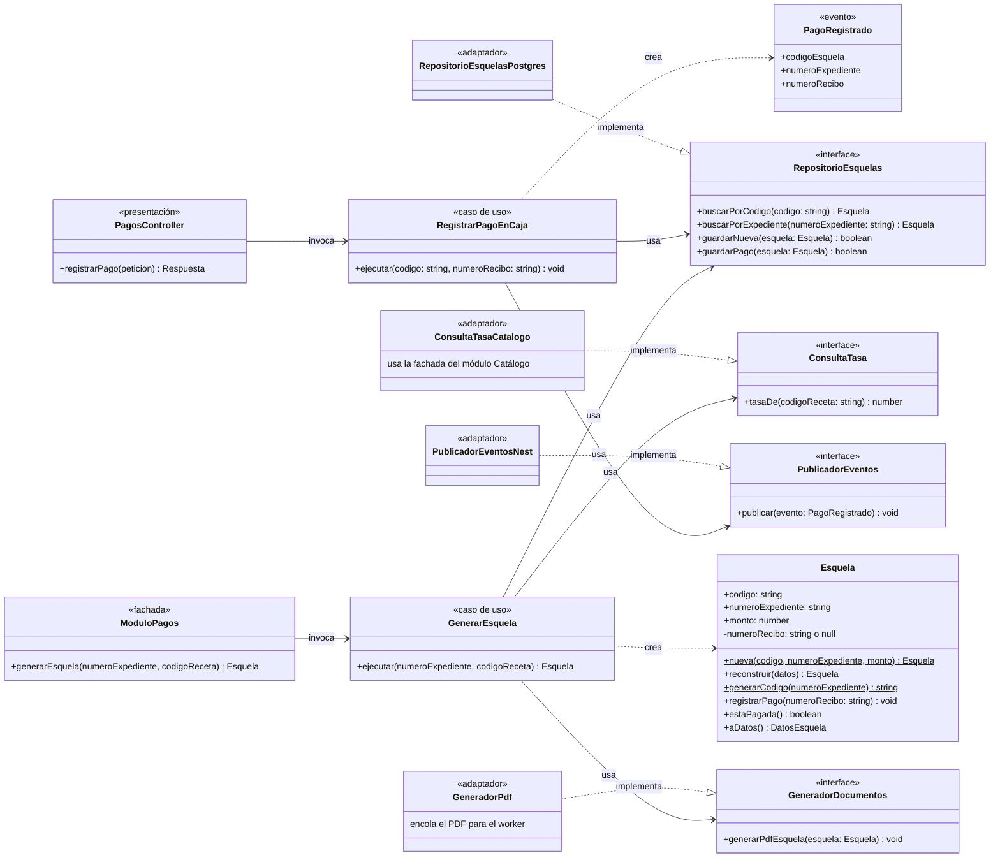

# C4 – Nivel 4: Diagrama de código

**Qué muestra:** las clases e interfaces de un componente. Se documenta el componente
**Pagos en caja**, porque concentra la decisión ADR-004 (pago presencial con esquela) y muestra
Clean Architecture (ADR-003).

## Cómo leer el diagrama

| Capa | Clases |
|---|---|
| **Dominio** | `Esquela`, `PagoRegistrado` y los contratos `RepositorioEsquelas`, `ConsultaTasa`, `GeneradorDocumentos` y `PublicadorEventos` |
| **Aplicación** | `GenerarEsquela`, `RegistrarPagoEnCaja` y la fachada `ModuloPagos` |
| **Infraestructura** | `RepositorioEsquelasPostgres`, `ConsultaTasaCatalogo`, `GeneradorPdf`, `PublicadorEventosNest` |
| **Presentación** | `PagosController` (solo el rol de caja puede registrar pagos) |

**Reglas del dominio:**
- `Esquela.registrarPago()` rechaza el registro si la esquela ya fue pagada.
- `Esquela.reconstruir()` crea la esquela leída de la base **con su número de recibo**, así una esquela pagada sigue pagada.
- `guardarNueva()` y `guardarPago()` deben ser **atómicos**: si se pide la esquela dos veces a la vez, solo se crea una (en PostgreSQL: `INSERT ... ON CONFLICT (numero_expediente) DO NOTHING`); si dos cajeros registran la misma esquela a la vez, solo uno lo logra (`UPDATE ... WHERE numero_recibo IS NULL`).
- El monto **no se recibe desde afuera**: `GenerarEsquela` lo pide al catálogo mediante `ConsultaTasa` (RF05, ADR-002).
- Un expediente tiene **una sola esquela**: el código es `ESQ-<expediente>`, con una restricción UNIQUE sobre el número de expediente. Si se vuelve a pedir, `GenerarEsquela` devuelve la misma esquela, así nadie paga dos veces.
- La esquela se genera solo con el nivel de riesgo confirmado, así el monto siempre coincide con la licencia.

**Versión de producción:** el diagrama muestra la versión simple, en la que `RegistrarPagoEnCaja` llama a `PublicadorEventos`.
En producción se usa **outbox**: el pago y el evento `PagoRegistrado` se guardan juntos en la tabla `eventos_pendientes` y los
workers lo entregan a Trámites (como muestran los niveles 2 y 3).

**Límite del módulo:** `Expediente` **no aparece** aquí porque pertenece al módulo Trámites. Pagos no lo
modifica: solo publica `PagoRegistrado`, y Trámites reacciona marcando su expediente como pagado.

**Otros casos de uso del módulo:** `ConsultarEsquela` (caja) y `CorregirNumeroRecibo` (jefatura, con motivo y
auditoría) siguen la misma estructura; no se dibujan para que el diagrama se lea con facilidad (ver el diseño interno de módulos).

Las flechas `..|>` muestran la **inversión de dependencias**: los adaptadores dependen de los contratos
del dominio, nunca al revés. El código de ejemplo está en `tecnologia/README.md`.