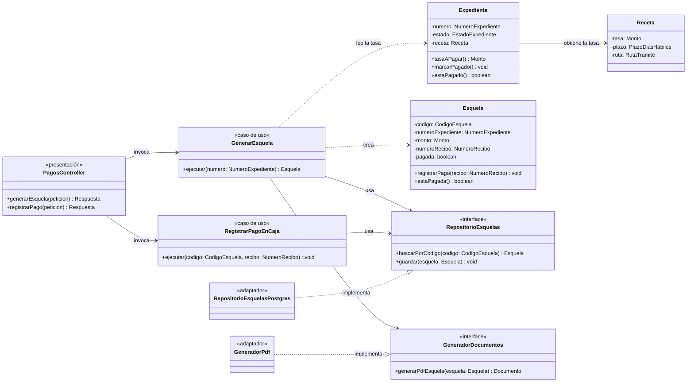

# C4 – Nivel 4: Diagrama de código

**Qué muestra:** las clases e interfaces de un componente. Se documenta el componente
**Pagos en caja**, porque concentra la decisión ADR-004 (pago presencial con esquela) y muestra
Clean Architecture (ADR-003).

## Cómo leer el diagrama

| Capa | Clases |
|---|---|
| **Dominio** | `Expediente`, `Receta`, `Esquela` y los contratos `RepositorioEsquelas` y `GeneradorDocumentos` |
| **Aplicación** | `GenerarEsquela`, `RegistrarPagoEnCaja` |
| **Infraestructura** | `RepositorioEsquelasPostgres`, `GeneradorPdf` |
| **Presentación** | `PagosController` (solo el rol de caja puede registrar pagos) |

**Regla del dominio:** `Esquela.registrarPago()` rechaza el registro si la esquela ya fue pagada.

Las flechas `..|>` muestran la **inversión de dependencias**: los adaptadores dependen de los contratos
del dominio, nunca al revés. El código de ejemplo está en `tecnologia/README.md`.