# Modelo de datos

El sistema guarda su información en **una sola base PostgreSQL (RC09)** dividida en **un esquema por módulo**
(ADR-001). Son 28 tablas en 9 esquemas. El modelo físico completo está en [`esquema.sql`](esquema.sql) y los datos
iniciales (roles, las 9 recetas del TUPA, sus requisitos y el asistente) en [`datos-semilla.sql`](datos-semilla.sql).

> Ambos archivos se ejecutaron sin errores en PostgreSQL 16, y se comprobaron tres reglas: un expediente no
> puede tener dos esquelas, una esquela no se paga dos veces y un vencimiento no genera dos alertas.

## Decisiones del modelo

| N.° | Decisión                                                                                                                                                                                      | Motivo                                                                                                                                                                     | Relación                |
| --- | --------------------------------------------------------------------------------------------------------------------------------------------------------------------------------------------- | -------------------------------------------------------------------------------------------------------------------------------------------------------------------------- | ----------------------- |
| MD1 | Un esquema de PostgreSQL por módulo (`tramites`, `pagos`, `licencias`…)                                                                                                                       | Cada módulo es dueño de sus tablas; se ve en la base lo mismo que en el código.                                                                                            | ADR-001                 |
| MD2 | Claves foráneas **solo dentro** de un esquema. Entre módulos se guarda el identificador de negocio (`numero_expediente`, `codigo_receta`, `usuario_id`) sin FK                                | Ningún módulo depende de las tablas de otro; un módulo se puede extraer en el futuro sin romper la base. La consistencia entre módulos la cuidan las fachadas y el outbox. | ADR-001, ADR-003        |
| MD3 | Datos personales cifrados con AES-256-GCM en la aplicación (`*_cifrado`), con un HMAC-SHA256 para buscar (`*_hmac`)                                                                           | Se puede consultar por DNI/RUC sin guardarlo en claro (Ley N.° 29733).                                                                                                     | ADR-007, EQ-04          |
| MD4 | Reglas de negocio críticas protegidas también por la base: `UNIQUE (numero_expediente)` en esquela, `UPDATE … WHERE numero_recibo IS NULL`, `UNIQUE (numero_expediente, vence_en)` en alertas | Segunda defensa ante dos cajeros o dos instancias actuando al mismo tiempo.                                                                                                | ADR-004, ADR-006, EQ-07 |
| MD5 | Tabla `comun.evento_pendiente` (outbox)                                                                                                                                                       | El pago y su evento se guardan en la misma transacción; nunca hay un pago con el expediente detenido.                                                                      | ADR-005                 |
| MD6 | Tabla `comun.ejecucion_tarea` con clave `(nombre_tarea, fecha)`                                                                                                                               | Junto con `pg_try_advisory_lock`, la tarea diaria corre una sola vez aunque haya N instancias.                                                                             | ADR-006                 |
| MD7 | Estados y tipos con `CHECK`, no con `ENUM`                                                                                                                                                    | Agregar un valor es una migración simple.                                                                                                                                  | ADR-003                 |
| MD8 | La esquela **copia** el monto del catálogo al generarse                                                                                                                                       | Si el TUPA cambia una tasa, las esquelas ya emitidas conservan su monto.                                                                                                   | ADR-002, ADR-004        |
| MD9 | El QR lleva un `codigo_verificacion` aleatorio de 22 caracteres, no el número de licencia                                                                                                     | Nadie puede recorrer licencias adivinando números; la página pública muestra datos mínimos.                                                                                | ADR-007, RF13           |

## Diagrama entidad-relación

Las líneas continuas son claves foráneas dentro de un módulo. Las líneas punteadas son **referencias lógicas** entre
módulos (MD2): se guardan como un valor, sin clave foránea.

```mermaid
erDiagram
    %% ===== Seguridad y Usuarios =====
    USUARIO ||--o{ USUARIO_ROL : "tiene"
    ROL ||--o{ USUARIO_ROL : "se asigna en"
    USUARIO ||--o{ SESION : "abre"
    USUARIO |o--o{ CODIGO_OTP : "recibe"
    CODIGO_OTP |o--o| VERIFICACION_IDENTIDAD : "confirma"

    %% ===== Catálogo y Asistente =====
    RECETA ||--|{ REQUISITO : "exige"
    RECETA ||--o{ REGLA_ASISTENTE : "es resultado de"
    RECETA ||--o{ CAMBIO_RECETA : "registra"

    %% ===== Trámites =====
    EXPEDIENTE ||--o{ DOCUMENTO : "adjunta"
    EXPEDIENTE ||--o{ OBSERVACION : "recibe"
    EXPEDIENTE ||--|{ HISTORIAL_ESTADO : "registra"
    EXPEDIENTE ||--o{ CLAVE_IDEMPOTENCIA : "evita duplicados"

    %% ===== Pagos en caja =====
    ESQUELA ||--o{ AUDITORIA_PAGOS : "audita"

    %% ===== Inspecciones =====
    INSPECCION ||--o{ FOTO : "incluye"
    INSPECCION ||--o{ AUDITORIA_INSPECCIONES : "audita"

    %% ===== Licencias =====
    LICENCIA ||--o{ CERTIFICADO_ITSE : "tiene"
    LICENCIA |o--o| LICENCIA : "reemplaza a"

    %% ===== Referencias lógicas entre módulos (sin FK) =====
    RECETA ||..o{ EXPEDIENTE : "codigo_receta"
    REQUISITO ||..o{ DOCUMENTO : "requisito_id"
    EXPEDIENTE ||..o| ESQUELA : "numero_expediente"
    EXPEDIENTE ||..o{ INSPECCION : "numero_expediente"
    EXPEDIENTE ||..o{ LICENCIA : "numero_expediente"
    EXPEDIENTE ||..o{ ALERTA : "numero_expediente"
    EXPEDIENTE ||..o{ MENSAJE : "numero_expediente"
    USUARIO ||..o{ EXPEDIENTE : "evaluador_id"
    USUARIO ||..o{ INSPECCION : "inspector_id"

    USUARIO {
        uuid id PK
        bytea correo_cifrado "AES-256-GCM"
        bytea correo_hmac UK
        varchar nombre_completo
        varchar clave_hash "argon2id"
        bytea celular_cifrado
        boolean activo
        boolean debe_cambiar_clave "clave temporal"
        integer version_seguridad "revocación inmediata"
    }
    ROL {
        varchar codigo PK "MESA_PARTES, EVALUADOR, INSPECTOR, CAJA, JEFATURA, ADMINISTRADOR"
        varchar nombre
    }
    USUARIO_ROL {
        uuid id PK
        uuid usuario_id FK
        varchar rol_codigo FK
        uuid asignado_por
        timestamptz asignado_en
        uuid retirado_por "NULL si vigente"
        timestamptz retirado_en "NULL si vigente"
    }
    SESION {
        uuid id PK
        uuid usuario_id FK
        varchar refresh_hash "SHA-256"
        varchar refresh_anterior_hash "detecta reutilización"
        timestamptz vence_maximo_en "8 horas"
        timestamptz ultima_actividad_en "30 minutos"
        timestamptz revocada_en
    }
    CODIGO_OTP {
        uuid id PK
        varchar proposito "INICIO_SESION o IDENTIDAD_ADMINISTRADO"
        bytea destino_hmac
        smallint intentos "máx. 5"
        timestamptz vence_en "5 minutos"
    }
    VERIFICACION_IDENTIDAD {
        uuid id PK
        bytea documento_hmac
        bytea ruc_hmac
        varchar resultado_servicio
        uuid codigo_otp_id FK
        bytea representante_documento_hmac "004"
    }
    RECETA {
        varchar codigo PK "LIC-01 a LIC-09"
        varchar codigo_tupa UK
        char ruta "A, B o C"
        varchar nivel_riesgo
        numeric tasa
        smallint plazo_dias
        varchar calificacion
        varchar orden_itse
        smallint vigencia_meses
    }
    REQUISITO {
        bigint id PK
        varchar codigo_receta FK
        smallint orden
        text descripcion
        varchar condicion
    }
    REGLA_ASISTENTE {
        bigint id PK
        smallint prioridad UK
        jsonb condiciones
        varchar codigo_receta FK
    }
    CAMBIO_RECETA {
        bigint id PK
        varchar codigo_receta FK
        uuid usuario_id "sin FK (MD2)"
        timestamptz cambiado_en
        jsonb cambios "antes y despues"
    }
    EXPEDIENTE {
        uuid id PK
        varchar numero UK "EXP-2026-000001"
        varchar codigo_receta
        char ruta
        varchar estado
        varchar canal
        bytea documento_cifrado
        bytea documento_hmac
        varchar giro
        varchar zona
        date vence_plazo_en
        smallint plazo_restante_dias
        uuid evaluador_id
        integer version
        jsonb receta_al_presentar "004"
        uuid verificacion_id UK "004, un solo uso"
        boolean con_representante "004"
    }
    DOCUMENTO {
        uuid id PK
        uuid expediente_id FK
        bigint requisito_id
        smallint requisito_orden "004"
        varchar clave_almacen UK
        char sha256
    }
    DOCUMENTO_TEMPORAL {
        uuid id PK
        varchar clave_almacen UK
        varchar tipo_mime
        integer tamano_bytes "1 a 10485760"
        char sha256
        uuid verificacion_id "en línea"
        uuid usuario_id "mesa de partes"
        timestamptz subido_en "se descarta a las 24 h"
    }
    CLAVE_IDEMPOTENCIA {
        uuid clave PK
        char huella_cuerpo
        uuid expediente_id FK
    }
    OBSERVACION {
        bigint id PK
        uuid expediente_id FK
        text descripcion
        date plazo_subsanar_en
    }
    HISTORIAL_ESTADO {
        bigint id PK
        uuid expediente_id FK
        varchar estado_anterior
        varchar estado_nuevo
        timestamptz ocurrido_en
    }
    ESQUELA {
        varchar codigo PK "ESQ-EXP-2026-000001"
        varchar numero_expediente UK
        numeric monto
        varchar numero_recibo UK "NULL = pendiente"
        timestamptz pagada_en
    }
    AUDITORIA_PAGOS {
        bigint id PK
        varchar codigo_esquela FK
        varchar accion
        text motivo
    }
    INSPECCION {
        uuid id PK
        varchar numero_expediente
        varchar tipo "PREVIA, POSTERIOR o BODEGA"
        uuid inspector_id
        varchar resultado
    }
    FOTO {
        uuid id PK
        uuid inspeccion_id FK
        varchar clave_almacen UK
    }
    AUDITORIA_INSPECCIONES {
        bigint id PK
        uuid inspeccion_id FK
        varchar accion
    }
    LICENCIA {
        uuid id PK
        varchar numero UK "LF-2026-000001"
        varchar numero_expediente
        varchar tipo "DEFINITIVA o PROVISIONAL"
        char codigo_verificacion UK "token del QR"
        date vigente_hasta
        uuid reemplaza_a FK
    }
    CERTIFICADO_ITSE {
        uuid id PK
        uuid licencia_id FK
        date vence_en
        timestamptz aviso_enviado_en
    }
    ALERTA {
        bigint id PK
        varchar numero_expediente
        date vence_en
    }
    MENSAJE {
        uuid id PK
        varchar canal "CORREO o SMS"
        varchar plantilla
        varchar estado
    }
```

No se dibujan las tablas sin relaciones: `comun.evento_pendiente`, `comun.ejecucion_tarea`, `plazos.feriado`,
`catalogo.pregunta_asistente`, `tramites.auditoria` y `licencias.auditoria`.

## Diccionario de datos

### Esquema `seguridad` (Seguridad y Usuarios)

| Tabla                    | Para qué sirve                                                               | Columnas clave y reglas                                                                                                                                                                                                                                             |
| ------------------------ | ---------------------------------------------------------------------------- | ------------------------------------------------------------------------------------------------------------------------------------------------------------------------------------------------------------------------------------------------------------------- |
| `rol`                    | Los 6 roles del personal (RF17).                                             | `codigo` con `CHECK` de los 6 valores.                                                                                                                                                                                                                              |
| `usuario`                | Personal municipal (RF22).                                                   | `correo_cifrado` + `correo_hmac` único (MD3); `clave_hash` con argon2id; `celular_cifrado` para el OTP; `activo` permite desactivar sin borrar; `debe_cambiar_clave` para la clave temporal; `version_seguridad` para revocar al instante.                          |
| `usuario_rol`            | Un usuario puede tener varios roles; historial de asignaciones (FR-019).     | Historial: `id` propio, `retirado_por`/`retirado_en`; un rol vigente por usuario con índice único parcial (`ux_usuario_rol_vigente`); guarda quién asignó y cuándo.                                                                                                 |
| `sesion`                 | Refresh tokens del personal.                                                 | `refresh_hash` (nunca el token en claro); `vence_maximo_en` (8 h), `ultima_actividad_en` (30 min), rotación con `refresh_anterior_hash`/`rotada_en`; `revocada_en` para cerrar sesión.                                                                              |
| `codigo_otp`             | Códigos de un solo uso (RF06, RF16).                                         | Vence a los 5 min; `intentos` ≤ 5; `codigo_hash`, nunca el código en claro.                                                                                                                                                                                         |
| `verificacion_identidad` | Resultado de validar DNI/RUC con el servicio externo + OTP del administrado. | `resultado_servicio`: `VALIDO`, `NO_VALIDO`, `NO_DISPONIBLE`; `confirmada_en` se llena al verificar el OTP; solo huellas HMAC (documento, RUC y, si actúa, el del representante, 004). El uso único del permiso lo garantiza `tramites.expediente.verificacion_id`. |

### Esquema `catalogo` (Catálogo y Asistente de ruta)

| Tabla                | Para qué sirve                                                                    | Columnas clave y reglas                                                                                                                                                                                                                                                                        |
| -------------------- | --------------------------------------------------------------------------------- | ---------------------------------------------------------------------------------------------------------------------------------------------------------------------------------------------------------------------------------------------------------------------------------------------- |
| `receta`             | Un procedimiento del TUPA: las 9 licencias y los 3 trámites conectados (ADR-002). | `tasa` (0 = gratuito), `plazo_dias`, `tipo_plazo`, `calificacion`, `orden_itse`, `vigencia_meses` (NULL = indeterminada); `codigo_tupa` y `pagina_tupa` para trazar al TUPA.                                                                                                                   |
| `requisito`          | Documentos que exige cada receta (RF04).                                          | `condicion`: `SIEMPRE`, `CON_REPRESENTANTE`, `GIRO_ESPECIAL`, `SIN_PLANOS_VIGENTES`; con eso el formulario dinámico decide qué pedir. `UNIQUE (codigo_receta, orden)` es diferible para reordenar en una transacción; el `id` se conserva al editar porque lo usarán los documentos de la 004. |
| `cambio_receta`      | Registro inmutable de cada modificación de una receta (RF21, funcionalidad 003).  | Quién (`usuario_id`, sin FK, MD2), cuándo (`cambiado_en`) y qué (`cambios`: `{campo: {antes, despues}}`, nunca vacío). Se escribe en la misma transacción que el cambio; nunca se actualiza ni se borra.                                                                                       |
| `pregunta_asistente` | Las preguntas del asistente (RF01).                                               | `opciones` en JSON; `NIVEL_RIESGO` incluye "No lo sé" (`NO_SE`), que ninguna regla usa.                                                                                                                                                                                                        |
| `regla_asistente`    | Convierte las respuestas en una receta.                                           | Se evalúan por `prioridad`; gana la primera cuyas `condiciones` están todas contenidas en las respuestas. La evaluación la hace el dominio de la aplicación (motor de reglas puro, 003), no SQL.                                                                                               |

### Esquema `tramites` (Trámites)

| Tabla                | Para qué sirve                                                                                                                                          | Columnas clave y reglas                                                                                                                                                                                                                                                                                                                                                                                                                                                                                                                                            |
| -------------------- | ------------------------------------------------------------------------------------------------------------------------------------------------------- | ------------------------------------------------------------------------------------------------------------------------------------------------------------------------------------------------------------------------------------------------------------------------------------------------------------------------------------------------------------------------------------------------------------------------------------------------------------------------------------------------------------------------------------------------------------------ |
| `expediente`         | El trámite del administrado.                                                                                                                            | `numero` único (`EXP-AAAA-NNNNNN`, correlativo que no se reinicia, con `CHECK` de formato); `estado` con los 13 estados del ciclo de vida; DNI/RUC, celular, correo, dirección y representante cifrados; `documento_hmac`/`ruc_hmac` + `numero` permiten la consulta pública (RF03); `receta_al_presentar` guarda la receta con la que se presentó (004); `verificacion_id` con índice único parcial: un permiso de identidad, un expediente; `CHECK` de canal (en línea con verificación, mesa de partes con `registrado_por`); `version` para bloqueo optimista. |
| `documento`          | Archivos adjuntos.                                                                                                                                      | Solo PDF, JPG o PNG de hasta 10 MB; el archivo vive en el almacén (`clave_almacen`, volumen compartido por las instancias hasta la 010) y se guarda su `sha256` y el orden del requisito al presentar.                                                                                                                                                                                                                                                                                                                                                             |
| `documento_temporal` | Archivos subidos antes de presentar (004).                                                                                                              | Solo los usa quien los subió (`verificacion_id` o `usuario_id`, uno de los dos); se descartan a las 24 horas.                                                                                                                                                                                                                                                                                                                                                                                                                                                      |
| `clave_idempotencia` | Evita expedientes duplicados (004).                                                                                                                     | `clave` = `Idempotency-Key`; con otra `huella_cuerpo` la misma clave se rechaza.                                                                                                                                                                                                                                                                                                                                                                                                                                                                                   |
| `observacion`        | Observaciones del evaluador y su subsanación.                                                                                                           | Una por expediente (TUPA, 005); `plazo_subsanar_en` = 2 días hábiles (006; columna NULL desde la 0008); `subsanada_en` NULL = pendiente.                                                                                                                                                                                                                                                                                                                                                                                                                                                 |
| `historial_estado`   | Cada cambio de estado.                                                                                                                                  | Base del tablero de tiempos de atención (RF19).                                                                                                                                                                                                                                                                                                                                                                                                                                                                                                                    |
| `auditoria`          | Decisiones del evaluador (incluidas empezar la revisión y la subsanación, 0008), presentaciones, registros presenciales y consultas del detalle (RF25). | Se escribe en la misma transacción que la operación; `usuario_id` solo es NULL al presentar en línea (`PRESENTAR_EN_LINEA`) y al subsanar en línea (`SUBSANAR`, 0009). Sin datos personales.                                                                                                                                                                                                                                                                                                                                                                                                                 |

### Esquema `pagos` (Pagos en caja)

| Tabla       | Para qué sirve                               | Columnas clave y reglas                                                                                                                                                                                                |
| ----------- | -------------------------------------------- | ---------------------------------------------------------------------------------------------------------------------------------------------------------------------------------------------------------------------- |
| `esquela`   | La esquela de pago (RF11, RF12).             | `numero_expediente` único: una esquela por expediente; `numero_recibo` NULL = pendiente; el pago se registra con `UPDATE … WHERE numero_recibo IS NULL`; un `CHECK` exige que recibo, fecha y cajero se llenen juntos. |
| `auditoria` | Registro y corrección de pagos (RF24, RF25). | Una corrección exige `motivo` y `recibo_anterior`.                                                                                                                                                                     |

### Esquema `inspecciones` (Inspecciones ITSE)

| Tabla        | Para qué sirve                                           | Columnas clave y reglas                                                                                          |
| ------------ | -------------------------------------------------------- | ---------------------------------------------------------------------------------------------------------------- |
| `inspeccion` | Una ITSE previa, posterior o de bodega (RF10).           | `UNIQUE (numero_expediente, tipo)`; un solo `inspector_id`; `resultado` obligatorio cuando `estado = REALIZADA`; `numero_certificado` y `certificado_emitido_en` juntos (0010). |
| `foto`       | Fotos tomadas desde el celular.                          | Solo JPG o PNG de hasta 10 MB.                                                                                   |
| `auditoria`  | Asignación de inspector y registro del resultado (RF25). | —                                                                                                                |

### Esquema `licencias` (Licencias)

| Tabla              | Para qué sirve                            | Columnas clave y reglas                                                                                                                                                                                   |
| ------------------ | ----------------------------------------- | --------------------------------------------------------------------------------------------------------------------------------------------------------------------------------------------------------- |
| `licencia`         | La licencia emitida (RF13).               | `numero` único (`LF-AAAA-NNNNNN`); `codigo_verificacion` aleatorio para el QR; solo una licencia `VIGENTE` por expediente; `reemplaza_a` para transferencia, cambio de giro y la definitiva de la bodega. |
| `certificado_itse` | Certificado ITSE y su vencimiento (RF14). | `vence_en` (cada 2 años); `aviso_enviado_en` evita avisar dos veces.                                                                                                                                      |
| `auditoria`        | Emisión de licencias (RF25).              | `usuario_id` NULL = emisión automática de la ruta A.                                                                                                                                                      |

### Esquemas `plazos`, `notificaciones` y `comun`

| Tabla                    | Para qué sirve                               | Columnas clave y reglas                                                                                                                     |
| ------------------------ | -------------------------------------------- | ------------------------------------------------------------------------------------------------------------------------------------------- |
| `plazos.feriado`         | Calendario de feriados (RF23).               | `fecha` es la clave; `alcance` nacional, regional o local; 0010 siembra los nacionales de 2026.                                                                                  |
| `plazos.alerta`          | Alertas de vencimiento a la jefatura (RF08). | `UNIQUE (numero_expediente, vence_en)`: ni cero ni duplicadas (EQ-07); `atendida_por` (0010).                                                                      |
| `notificaciones.mensaje` | Correos y SMS pendientes y enviados (RF20).  | `evento_id` UNIQUE (0010): un aviso por evento; `intentos`, `reintentar_en` (0010) y `ultimo_error` para reintentos.                                                             |
| `comun.evento_pendiente` | Outbox de eventos de dominio.                | Índice parcial sobre los no procesados; `reintentar_en` (0008) espacia los reintentos del despachador; `ultimo_error` sin datos personales. |
| `comun.ejecucion_tarea`  | Ejecución única de tareas diarias (ADR-006). | PK `(nombre_tarea, fecha)`.                                                                                                                 |

## Índices pensados para los escenarios de calidad

| Índice                                            | Consulta que acelera                    | Escenario |
| ------------------------------------------------- | --------------------------------------- | --------- |
| `ix_expediente_consulta (numero, documento_hmac)` | Consulta pública del estado del trámite | EQ-01     |
| `ix_expediente_estado (estado, vence_plazo_en)`   | Tarea diaria del reloj de plazos        | EQ-07     |
| `ix_expediente_bandeja (evaluador_id, estado)`    | Bandeja del evaluador                   | EQ-01     |
| `ix_inspeccion_bandeja (inspector_id, estado)`    | Bandeja del inspector en el celular     | EQ-05     |
| `ix_itse_por_vencer (vence_en)` parcial           | Aviso de vencimiento del ITSE           | RF14      |
| `ix_evento_pendiente_sin_procesar` parcial        | Workers del outbox                      | EQ-03     |

## Pendientes

- El asistente de 3 preguntas y sus reglas son una propuesta: dependen de la duda N.° 2 del documento 09.
- El TUPA no tiene licencia para cesionarios de riesgo bajo; con las reglas actuales ese caso cae en `LIC-01`. Confirmar con la Municipalidad.
- Si se confirma la diferencia D1 (pago antes de presentar), la esquela se generaría antes del expediente y habría que revisar `pagos.esquela`.
