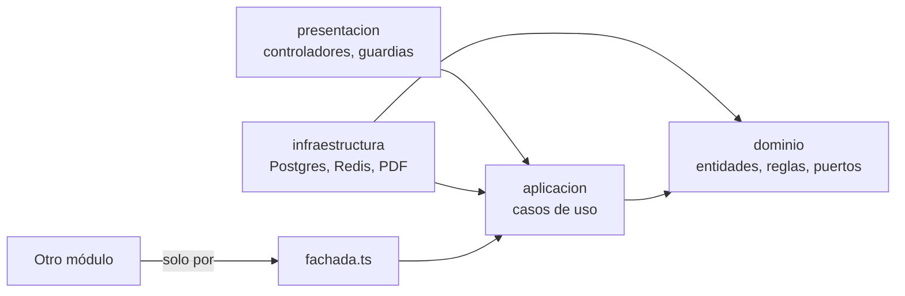

# Principios SOLID y patrones de diseño (Sprint 2)

Cada ejemplo cita el **archivo** y un **fragmento** literal entre « ». El script
[`tests/analisis/verificar-citas.mjs`](../../tests/analisis/verificar-citas.mjs) comprueba que cada
archivo existe y contiene su fragmento, para que el documento no quede desactualizado.

## 1. Estilo y enfoque

- **Estilo**: monolito modular (ADR-001). Hay 9 módulos de negocio en `apps/api/src/modulos/`.
  Comparten un proceso y una base, pero no el código.
- **Enfoque**: Clean Architecture (ADR-003). Cada módulo tiene cuatro capas y las dependencias apuntan
  hacia el dominio.

La **regla de dependencia** la comprueba `dependency-cruiser` en cada pull request (job
`regla-dependencia` de [`.github/workflows/ci.yml`](../../.github/workflows/ci.yml), reglas en
[`.dependency-cruiser.cjs`](../../.dependency-cruiser.cjs)):

- el dominio no importa paquetes ni otras capas;
- la aplicación no importa infraestructura ni presentación;
- un módulo solo usa a otro por su `fachada.ts`;
- no hay ciclos.

En la última ejecución local: «0 violaciones, 332 módulos y 1,301 dependencias revisados».

## 2. SOLID con ejemplos reales

| Principio | Ejemplo real (archivo y fragmento) | Qué se gana | Qué se perdería sin él |
| --- | --- | --- | --- |
| **S**: responsabilidad única | `apps/api/src/compartido/dominio/calendario-habil.ts` — «`export class CalendarioHabil`». Solo sabe contar días hábiles con los feriados que recibe | La misma regla sirve al reloj de plazos, al tablero y a la subsanación, con pruebas unitarias propias | Cada módulo calcularía días hábiles a su manera y el tablero contradiría a las alertas |
| **O**: abierto/cerrado | `apps/api/src/modulos/tramites/dominio/maquina-estados.ts` — «`const TRANSICIONES`». Las rutas A, B y C son datos de una tabla, y las 9 recetas del TUPA son datos del catálogo (ADR-002) | Una ruta o una receta nueva se agrega sin tocar los casos de uso | Cada tipo de licencia sería un `if` nuevo en el código |
| **L**: sustitución de Liskov | `apps/api/src/modulos/catalogo/infraestructura/repositorio-catalogo-con-cache.ts` — «`export class RepositorioCatalogoConCache implements RepositorioCatalogo`» | El repositorio con caché reemplaza al de PostgreSQL sin que los casos de uso lo noten | Habría que cambiar los casos de uso para usar la caché |
| **I**: segregación de interfaces | `apps/api/src/modulos/pagos/fachada.ts` — «`private readonly esquelas: Pick<RepositorioEsquelas, 'obtener'>`». La fachada solo pide lo que usa; el decorador de caché solo pide `get` y `set` (`ClienteCache`) | Las pruebas usan dobles pequeños y un cambio en el repositorio no rompe la fachada | Cada doble de prueba tendría que implementar el repositorio completo |
| **D**: inversión de dependencias | `apps/api/src/modulos/seguridad/dominio/puertos/enviador-otp.ts` — «`export interface EnviadorOTP`». El caso de uso depende del puerto, y el módulo elige el adaptador: `apps/api/src/modulos/seguridad/seguridad.module.ts` — «`useFactory: (redis: Redis): EnviadorOTP => new EnviadorOtpSimulado(redis)`» | El envío por SMS real será otro adaptador, sin tocar el dominio | El dominio dependería de Redis o del proveedor de SMS, y no se podría probar sin ellos |

## 3. Patrones usados

| Patrón | Dónde (archivo y fragmento) | Para qué |
| --- | --- | --- |
| **Puertos y adaptadores** (hexagonal) | `apps/api/src/modulos/seguridad/dominio/puertos/servicio-identificacion.ts` — «`export interface ServicioIdentificacion`» | El dominio define qué necesita (validar DNI y RUC) y la infraestructura lo implementa (hoy simulado) |
| **Fachada por módulo** | `apps/api/src/modulos/pagos/fachada.ts` — «`export class FachadaPagos`» | Es la única puerta de entrada de un módulo para los demás (regla `aislamiento-entre-modulos`) |
| **Repositorio** | `apps/api/src/modulos/catalogo/dominio/repositorio-catalogo.ts` — «`export interface RepositorioCatalogo`» | El dominio guarda y lee entidades sin saber de SQL |
| **Unidad de trabajo** | `apps/api/src/modulos/catalogo/infraestructura/unidad-de-trabajo-catalogo-postgres.ts` — «`export class UnidadDeTrabajoCatalogoPostgres implements UnidadDeTrabajoCatalogo`» | Guarda la receta, sus requisitos y el historial del cambio en una sola transacción |
| **Decorador** (cache-aside) | `apps/api/src/modulos/catalogo/infraestructura/repositorio-catalogo-con-cache.ts` — «`Decorator con cache-aside sobre el repositorio del catálogo`» | Agrega caché sin cambiar el repositorio ni los casos de uso |
| **Estrategia** (adaptadores intercambiables) | `apps/api/src/modulos/seguridad/infraestructura/servicio-identificacion-simulado.ts` — «`export class ServicioIdentificacionSimulado implements ServicioIdentificacion`», y `apps/api/src/modulos/seguridad/infraestructura/enviador-otp-simulado.ts` — «`export class EnviadorOtpSimulado implements EnviadorOTP`» | Simulado en desarrollo y real cuando se contrate, según la configuración (ADR-003) |
| **Máquina de estados** | `apps/api/src/modulos/tramites/dominio/maquina-estados.ts` — «`export const siguienteEstado`» | Solo se permiten las transiciones válidas de cada ruta; lo demás es 409 |
| **Bandeja de salida (outbox) y cola de eventos** | `apps/api/src/compartido/infraestructura/despachador-eventos.ts` — «`FOR UPDATE SKIP LOCKED`» | El evento se guarda en la misma transacción que el cambio y se procesa después, una sola vez, aunque haya 2 réplicas (ADR-005) |
| **Objeto de valor** | `apps/api/src/modulos/tramites/dominio/numero-expediente.ts` — «`export class NumeroExpediente`», y `apps/api/src/modulos/seguridad/dominio/correo.ts` — «`export class Correo`» | Un número o un correo inválido no puede existir en el dominio: se valida al crearlo |
| **Guardias de NestJS** | `apps/api/src/modulos/seguridad/presentacion/roles.guard.ts` — «`export class RolesGuard implements CanActivate`» | Sesión y roles se revisan antes de entrar al controlador (401 y 403, matrices de permisos) |
| **Adaptador anticorrupción** | `apps/api/src/modulos/reportes/infraestructura/fuentes-fachadas.ts` — «`export class FuenteTramitesFachada implements FuenteTramites`» | Reportes traduce lo que le dan las fachadas a sus propios puertos, sin depender de otros dominios |

## 4. Evidencia automática

- Regla de dependencia: job `regla-dependencia` del CI, en verde en cada PR.
- Pruebas de la regla: `apps/api/test/regla-dependencia/`. Usan módulos de ejemplo que la violan a
  propósito y comprueban que `dependency-cruiser` las detecta.
- Estructura: `apps/api/test/unit/estructura-modulos.spec.ts` comprueba los 9 módulos y sus capas.
